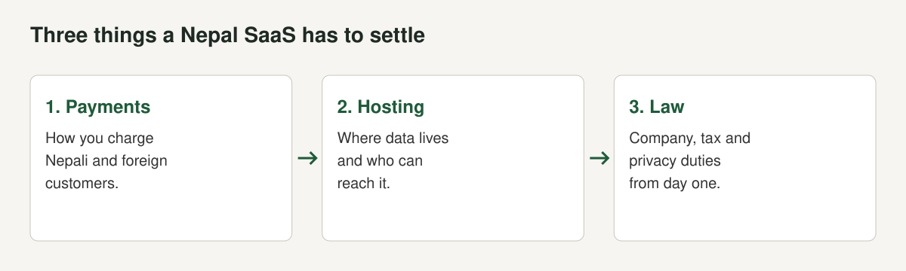

Software as a service looks easy from Kathmandu. You write the code here, host it anywhere, sell it by subscription and the customer pays by card. Each of those steps has a Nepal-specific catch, and most show up in the first month.

This is the overview. It names the things to settle, cites the law where we opened it, and points to a guide for each. We are a product group building AirFone, ePahichan, LunaCam, eShasan and LunaIoT. We are not lawyers or accountants, and nothing here is legal or tax advice.

## The law most SaaS founders miss: the E-Commerce Act, 2081

The Electronic Commerce (E-Commerce) Act, 2081 came into force on the thirty-first day from its ratification, according to [section 1](https://nepallaws.com/Laws/electronic-commerce-e-commerce-act-2081/chapter-1-preliminary/section-1-short-title-commencement-and-extension/), which also says it applies "throughout Nepal" and to "any person residing anywhere outside Nepal who provides goods or services in Nepal through electronic commerce". We read the nepallaws.com text, an unauthorised translation, plus [Pioneer Law's commentary](https://pioneerlaw.com/?p=1346) (checked October 2026).

### Does it cover SaaS?

[Section 2](https://nepallaws.com/Laws/electronic-commerce-e-commerce-act-2081/chapter-1-preliminary/section-2-definitions/) defines the key terms.

| Term | Definition (paraphrased from the text) | Why it matters |
|---|---|---|
| Electronic platform, s.2(k) | A system to collect, transmit or store information through websites, applications, software, the Internet, social media marketplaces and similar | A SaaS product is one |
| Electronic trade, s.2(l) | Buying or selling any goods or services through an electronic platform. Using a platform only to give information or promote is not e-commerce | A paid subscription is a sale |
| Service, s.2(p) | Electricity, drinking water, telephone, information technology, health, education and consulting, shipping, tourism, entertainment, transportation, sewage maintenance, banking, insurance or similar, and legal, audit, medical or engineering services | Information technology is named |
| List-based electronic business operator, s.2(o) | A firm that lists goods or services it holds and sells them directly to consumers through a platform | A SaaS company selling its own product fits |

Pioneer Law's commentary says the definitions are broad with unclear boundaries, and asks whether licensed banks and wallets, or foreign providers of services such as cloud storage, must list. It says that read strictly, many foreign digital services would fall within the Act. It is a commentary, not a court ruling. If you sell software as a service to people in Nepal, assume the Act applies and ask a lawyer to confirm.

### What the commentary warns about

Pioneer Law's commentary, published on 11 June 2025, raises four points a SaaS founder should know:

- **Breadth.** The Act defines e-commerce broadly and the definition of services includes licensed and regulated services, so licensed banks and wallets, or lawyers advising by video call, might in theory fall inside it. The firm calls the boundaries unclear.
- **Foreign providers.** The Act "mandates any person selling their services and/or products through the internet in Nepal" to be listed, which on a strict reading reaches foreign cloud and software subscriptions. The firm adds that enforcing against companies with no presence in Nepal "poses significant jurisdictional challenges".
- **Electronic contracts.** Online agreements, including those accepted by clicking "I Agree", now carry legal validity, and the Act's recognition of digital authentication is broader than the Electronic Transactions Act, 2063, which limited validity to signatures issued by certified authorities, according to the firm.
- **Unfair practices.** The Act prohibits unfair commercial practices but does not define them for e-commerce, so the firm expects regulations to fill the gap.

The practical reading is that a Nepali SaaS company selling to Nepali buyers is the easiest case for the Act, a foreign one selling into Nepal is a harder case, and the fines are modest enough that most of the risk is a regulator's attention rather than a large penalty. That last part is our judgement, not the firm's.

### What it requires

| Section | Requirement | Source |
|---|---|---|
| s.3(1) | Only a firm, company or organisation registered under prevailing law and permitted to trade in the goods or services may carry out electronic trading | [Section 3](https://nepallaws.com/Laws/electronic-commerce-e-commerce-act-2081/chapter-2-operation-of-electronic-commerce/section-3-electronic-trading-may-be-carried-out/) |
| s.4(1) | Every entrepreneur conducting e-commerce shall establish an e-platform. Small entrepreneurs may use other platforms | [Section 4](https://nepallaws.com/Laws/electronic-commerce-e-commerce-act-2081/chapter-2-operation-of-electronic-commerce/section-4-establishment-of-an-electronic-platform/) |
| s.4(2) | The platform shows: platform name; business name, address, registered entity and registration certificate number; offices and branches; any separate licence; whether the business is intermediary or list-based; VAT or PAN number; contact details and customer service contacts; the complaints contact; the listing number | Section 4 |
| s.4(3) | Update those details within forty-eight hours of a change | Section 4 |
| s.5(1) | After establishing the platform, apply electronically for listing on the Department's e-commerce portal with business name, address, registration number, proprietor or director details, business details, VAT or PAN number, contact details and branches | [Section 5](https://nepallaws.com/Laws/electronic-commerce-e-commerce-act-2081/chapter-2-operation-of-electronic-commerce/section-5-registration-required/) |
| s.5(2) | Existing e-commerce businesses to apply within three months of commencement | Section 5 |
| s.5(3) | The Department gives the platform registration number within seven days of receiving the application | Section 5 |
| s.5(4) | Update branch or outlet changes within seven days | Section 5 |
| s.6 | Disclose, on the platform, details of the goods or services: name and nature; final selling price including tax; additional charges; precautions; timing; payment method; warranty; the provider; conditions after purchase; whether refundable and the terms; where a service is received; whether a request can be cancelled; the main contract terms in language the general public understands; and a mechanism for reviews, ratings, complaints and feedback | [Section 6](https://nepallaws.com/Laws/electronic-commerce-e-commerce-act-2081/chapter-2-operation-of-electronic-commerce/section-6-disclosure-of-details/) |
| s.7(2) | In an electronic contract, disclose terms on provision, cancellation, return, exchange, warranty, guarantee and refund | [Section 7](https://nepallaws.com/Laws/electronic-commerce-e-commerce-act-2081/chapter-2-operation-of-electronic-commerce/section-7-deemed-to-be-a-contract/) |
| s.8(3) | Immediately make the bill and an electronic or physical receipt of payment available to the buyer, and keep a record | [Section 8](https://nepallaws.com/Laws/electronic-commerce-e-commerce-act-2081/chapter-2-operation-of-electronic-commerce/section-8-electronic-commerce-payments/) |
| s.10 | If goods or services are not as described under section 6, the buyer may return them without using them, and the entrepreneur shall take them back and refund tax-inclusive price if no replacement is accepted | [Section 10](https://nepallaws.com/Laws/electronic-commerce-e-commerce-act-2081/chapter-2-operation-of-electronic-commerce/section-10-goods-or-services-may-be-returned/) |
| s.11(2) | A businessperson selling to a foreign person through a platform operating in Nepal may export after ensuring payment through the banking system, subject to prevailing federal law | [Section 11](https://nepallaws.com/Laws/electronic-commerce-e-commerce-act-2081/chapter-2-operation-of-electronic-commerce/section-11-export-and-import-may-be-carried-out/) |
| s.12 | Keep personal information confidential, do not give it or use it except under law, and do not deprive a user of the facility to enter, amend and close their identifying details | [Section 12](https://nepallaws.com/Laws/electronic-commerce-e-commerce-act-2081/chapter-2-operation-of-electronic-commerce/section-12-personal-information-must-be-kept-confidential/) |
| s.15(e), (f), (h) | Preserve transaction records for the period set by tax law; deliver the service by the promised time except in force majeure; refund if the service is not as shown, late or defective | [Section 15](https://nepallaws.com/Laws/electronic-commerce-e-commerce-act-2081/chapter-3-obligations-of-parties-involved-in-electronic-commerce/section-15-responsibilities-of-traders-carrying-out-e-commerce-based-on-the-list/) |

Section 15(h) is the one that surprises subscription businesses. A refund duty applies if the service is not as displayed or agreed, is delivered late or is defective. Write your refund terms to match what you actually deliver and say them on the page.

### Penalties

| Offence | Penalty | Source |
|---|---|---|
| Trading without an electronic platform, without listing, or without the section 6 disclosure (s.21(a) to (c)), and breaches of listed duties under sections 14 to 16 (s.21(d)) | Fine of NPR 20,000 to NPR 100,000, imposed by the Inspection Officer, with appeal to the Director General within seven days | [Section 21](https://nepallaws.com/Laws/electronic-commerce-e-commerce-act-2081/chapter-4-offences-and-punishment/section-21-deemed-to-have-committed-an-offense/), [Section 22](https://nepallaws.com/Laws/electronic-commerce-e-commerce-act-2081/chapter-4-offences-and-punishment/section-22-fines-to-be-imposed/) |
| Breaches of the duties in s.21(e) | Fine of NPR 50,000 to NPR 500,000, or imprisonment of six months to three years, or both | [Section 23](https://nepallaws.com/Laws/electronic-commerce-e-commerce-act-2081/chapter-4-offences-and-punishment/section-23-punishment/) |

Enforcement is live. [Hamro Patro, republishing a techpana report of 18 August 2026](https://www.hamropatro.com/en/news/detail/4639130139724541-running-an-online-business-in-nepal-registration-is-mandatory-unregistered), says the Department of Commerce, Supply and Consumer Protection directed businesses selling goods and services online to register their e-commerce platforms, following the Act and the Electronic Commerce (E-Commerce) Directive, 2082. We could not open the directive.

## Company and tax

You need a registered company for section 3 and for a proper invoice. See [how to register a software company in Nepal](/blog/register-software-company-nepal) for the OCR steps, fees from NPR 1,000 and the first filing deadlines.

On tax, [Schedule 2, item 2 of the VAT Act](https://nepallaws.com/Laws/value-added-tax-act-2052/schedule-2-relating-to-sub-section-2-of-section-7/goods-and-services-subject-to-zero-rate/) zero-rates services supplied to persons outside Nepal on stated conditions, and section 11(3E)(c) of the Income Tax Act gives an IT service export concession. Alpine Law reports 75% for 2082/83 and 50% for 2083/84 in the budgets. Sales to customers in Nepal are standard-rated at 13% according to Alpine Law. Details and penalties are in [tax on software exports from Nepal](/blog/software-export-tax-nepal).

If you buy foreign software, Alpine Law says VAT on imported services is collected by the resident recipient by reverse charge, and that foreign B2C digital providers above NPR 3 million Nepal turnover pay a 2% digital service tax. That applies to your vendors, not to you, but it affects your tool costs.

## Payments

Two flows, two setups.

**Customers abroad.** Money must arrive through a Nepali bank in a way you can document. Section 11(2) of the E-Commerce Act says export follows payment ensured through the banking system. The routes, published fees and limits are in [how to accept international payments as a Nepali software company](/blog/international-payments-nepal-software-company). Three facts from that guide: PayPal is not operating in Nepal, Wise says it cannot send NPR to Nepali businesses, and Payoneer's published withdrawal rates with conversion run 1.2% to 4%, with Nepal not listed separately. For your own spending, NRB's April 2026 circular raised IT dollar card limits to US$3,000 a year, US$5,000 for exporters and up to US$100,000 for larger IT companies, as reported by Business 360.

**Customers in Nepal.** Domestic wallets and bank transfers are the common routes, and eSewa and Khalti publish consumer tariffs but not merchant rates, so ask for written quotes. Section 8 of the E-Commerce Act applies: give the buyer a bill and receipt immediately and keep a record. We did not find a rule on stored-card subscriptions, so confirm with a provider whether recurring charges are supported for your case.

## Hosting

A SaaS product holds its customers' data, so where it lives becomes a sales question. The Data Center and Cloud Service Directive, 2081 asks facilities holding government data to be rated at least Tier 3 and expects government systems to run in government data facilities unless an exception is approved. Pioneer Law's brief and our [directive guide](/blog/nepal-data-center-cloud-directive-2081) set it out. DLA Piper adds that recipients of data centre and cloud services may only procure from providers enlisted with the Department of Information Technology, and that licensed payment institutions may only host their data centres with listed entities. If you resell hosting or store others' data as your main job, read the directive for whether you are a provider. If you sell to government, see [selling software to Nepal's government](/blog/selling-software-to-government-nepal).

We would decide early where data will live, and build so that moving is possible. A product tied to one provider's special services cannot move when a customer's rules change.

## Privacy

The [Privacy Act, 2075 (2018)](/blog/individual-privacy-act-2075-apps) requires consent to collect personal data (section 12(2)), limits use to the purpose collected (12(3)) and bars recording electronic conversations without consent (19(3)). The E-Commerce Act adds a duty to keep personal information confidential and to let users amend their details and close their identification (section 12). Offences under the Privacy Act carry up to three years in prison or a fine of up to NPR 30,000, or both. The Act sets no breach notification or retention rule, and a draft IT bill passed the House in August 2025 but we could not confirm it became law.

## Security evidence

Larger customers ask for evidence that you protect data. ISO 27001 is one answer and it is costly. Amtivo's Irish arm publishes EUR 4,500 to EUR 7,000 for a business under 10 staff at one location, and a UK consultancy's audit-day table gives about GBP 6,250 for 1 to 10 employees. Nepal's directive asks hosting providers for information security certificates. See [ISO 27001 for Nepali software companies](/blog/iso-27001-nepal-software-company).

## Two markets, two billing setups

| | Customers in Nepal | Customers abroad |
|---|---|---|
| Currency | NPR | USD or other foreign currency |
| Payment route | Wallet, bank transfer or QR | Bank SWIFT, Payoneer or a processor that accepts your country |
| VAT | 13% standard rate | Zero-rated if Schedule 2 item 2 conditions are met |
| Income tax | Standard rate | Export concession, subject to the year's Finance Act |
| E-Commerce Act | Disclosure, listing, receipts, refunds | Section 11(2) banking system payment, plus listing |
| Proof to keep | Tax invoice, receipt | Contract, invoice, bank credit advice |

Keep both ledgers in one place. A report by currency, route and invoice makes tax time and any investor conversation easier.

## A realistic order of work

1. Register the company. Open a bank account that can receive foreign currency.
2. Decide VAT registration with an accountant before the first taxable transaction (VAT Act section 10(2)).
3. Pick your payment route and run one real transaction.
4. Decide where data will live and write it down.
5. Write the one-page data note: what you collect, why, who can read it, how long you keep it.
6. Build the platform disclosures required by sections 4 and 6 of the E-Commerce Act and apply for listing under section 5.
7. Write refund and cancellation terms that match what you deliver (sections 7, 10 and 15).
8. Only then build the billing screens. The money path decides what the screens must do.

## Mistakes we see

- **Not knowing the E-Commerce Act exists.** Trading without listing or disclosure is an offence with fines of NPR 20,000 to NPR 100,000.
- **Hiding refund terms in a footer.** Section 6 asks for them on the platform and the main contract terms in language the public understands.
- **Building billing last.** Payment limits shape plans, trials and refunds.
- **Collecting data you do not need.** Every extra field is a duty and a liability.
- **Choosing hosting by price alone.** It can rule you out of a tender.
- **Treating tax as a year-end task.** Export treatment depends on records made at the time of each sale.

## A checklist

- [ ] Company registered, PAN issued, VAT decided
- [ ] Bank account open, payment route tested with a real payment
- [ ] E-commerce listing applied for and listing number shown on the platform
- [ ] Section 6 disclosures and refund terms published
- [ ] Receipts issued immediately and records kept
- [ ] Data location and data note written
- [ ] Consent recorded and recording notices in place if you record calls
- [ ] Security baseline written, certification decision made
- [ ] Contract, invoice and bank record matched for every export

For the wider picture of exporting software from Nepal, see [Nepal's IT export boom](/blog/nepal-it-export-products).

## The short version

- The E-Commerce Act, 2081 covers information technology services sold through apps and software, applies to foreign sellers to Nepal, requires listing (s.5) and disclosure (s.6), and fines NPR 20,000 to NPR 100,000.
- Settle payments first. PayPal is not operating in Nepal and Wise cannot send NPR to Nepali businesses.
- Decide where data lives. Government data needs Tier 3 facilities.
- Company, tax and privacy duties start with your first customer.

*This post is not legal or tax advice. Check current rules with the relevant authority or a professional.*
