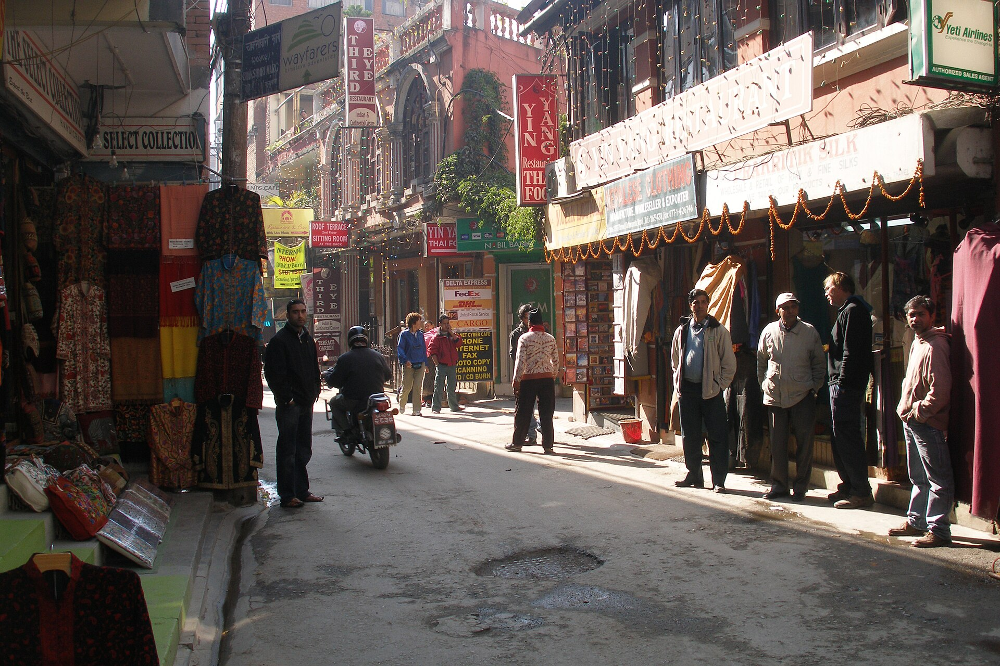

In a large company, capital allocation is a process with a calendar. In a small group it is a conversation that happens whether anyone calls it that. Every rupee that goes into one product is a rupee that does not go into another.

## Three buckets

Sort every product's spending into three buckets and look at each separately.

- **Keep running.** Servers, support, the people needed to stay reliable. This is not optional and should not be argued with each quarter.
- **Grow.** Spending that is expected to increase what the product earns or how many people use it. This is where the group should ask hard questions.
- **Reserve.** Cash kept back so that a bad quarter does not become a crisis.

## Ask what an extra rupee does

For the growth bucket, ask of each product what one more rupee would change. A product that is held back by one missing thing will use money well. A product that has no clear constraint will not, however much it asks for.

## Keep the reserve boring

Decide the reserve first, in months of running cost, and do not touch it for growth. Groups that spend the reserve when an opportunity looks good find out later why it was there.

