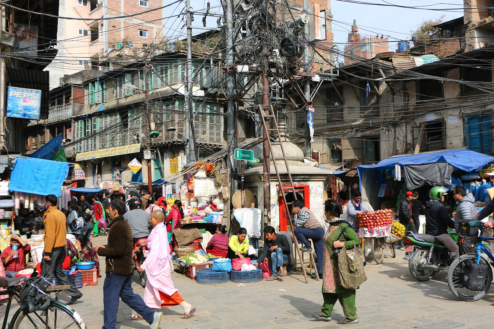
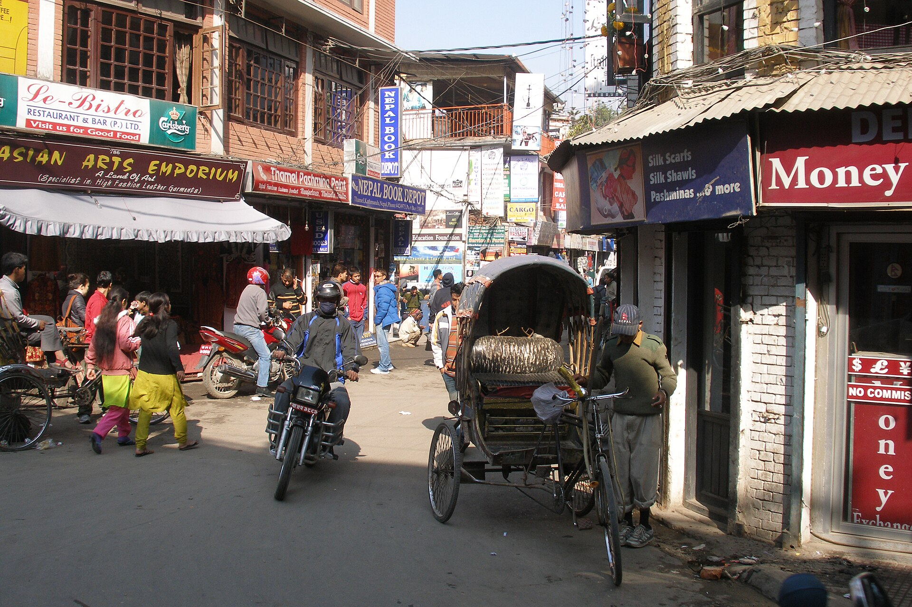

Every product in a group has a list of things it wants to build. Added together, the lists are always longer than the budget. Choosing between them is a strategy decision, not a scheduling one.

## Put every request in the same four lines

Before comparing, rewrite each request so it answers the same four questions.

1. **Who needs this?** A named kind of customer, not "users".
2. **What changes for them?** One sentence, in their words.
3. **What does it cost?** People and weeks, including the work around it.
4. **What happens if it waits a quarter?** Often the honest answer is "nothing", and that is useful to know.

## Compare reach before polish

A feature that many customers will use beats a better feature that few will use, unless the few are the ones who keep the product alive. Say which case you are in.

## Decide, and write the decision down

The output is a short list: what we build, what we do not, and when we look again. The "do not" half matters. Without it, the same request returns next month as if it were new.
