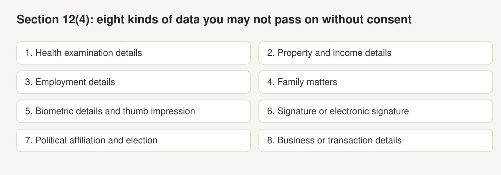
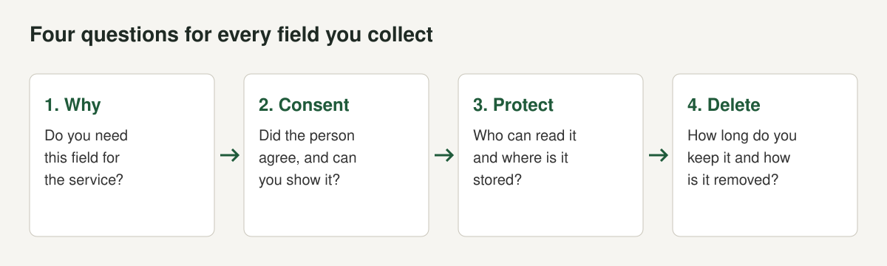

If your app in Nepal asks for a name, a phone number, a citizenship number or a face, you hold personal information and one statute speaks to it. It is shorter, older and thinner than most founders assume, and it is also more specific than "we collect data, so we are fine".

The Law Commission's English text is titled **The Privacy Act, 2075 (2018)**, and Pioneer Law and DLA Piper call it the Individual Privacy Act. We use the Commission's title and say "the Act". This post reads the Act itself, which we opened as [the English text published through the ADB's law and policy reform site, with the Law Commission header](https://lpr.adb.org/sites/default/files/resource/%5Bnid%5D/nepal-the-privacy-act-2075-2018-english.pdf), together with [DLA Piper's guide for Nepal](https://www.dlapiperdataprotection.com/index.html?c=NP&t=law), modified 20 March 2026 (both checked October 2026). We cite section numbers so you can check each point.

CCTV is a different topic with different rules, and we leave it to lunacam.app. Here we cover accounts, forms, databases, calls and messages.

We are a software group, not a law firm. The Act has gaps, and nothing here is legal advice.

## What the Act is

The Act was authenticated on 18 September 2018 (2075.6.2) as Act Number 14 of 2075. Its preamble says it is meant to ensure the right to privacy of matters relating to body, residence, property, document, data, correspondence and character of every person, to manage the protection and safe use of personal information held by any public body or institution, and to prevent encroachment on privacy. It has 36 sections in twelve chapters. Chapter 6 deals with data, chapter 9 with electronic means and chapter 10 with collection and protection of personal information. Chapter 11 sets offences and punishment.

A regulation made under the Act, the Privacy Regulation, 2077 (2020), is listed by DLA Piper. We could not open its text, so we do not describe it.

Three definitions matter for an app.

**Personal information (section 2(c))** is a closed list: caste, ethnicity, birth, origin, religion, colour or marital status; education or academic qualification; address, telephone or email; passport, citizenship certificate, national identity card number, driving licence, voter identity card or details of an identity card issued by a public body; a letter sent or received mentioning personal information; thumb impressions, fingerprints, retina, blood group or other biometric information; criminal background; and the opinion expressed by a person who gives professional or expert opinion in a decision. Notice what is not on the list: names, IP addresses and device identifiers. A name usually appears next to something that is on the list, but the Act does not define it separately. DLA Piper says there is no exclusive provision for cookies and location data, but that if such information is collected, the entity must adhere to the Act and use it only for the purpose collected.

**Body corporate (section 2(g))** means an organisation, company, bank, committee, cooperative association, federation or other body corporate of similar nature established under the prevailing law. A Nepali software company is a body corporate.

**Public body (section 2(e))** includes the government at all levels, courts, regulators, bodies owned or controlled by government, universities and schools operated or funded by government, and institutions operating with a credit, grant or guarantee of the government. If you sell to such a body, its duties under the Act flow down to you by contract. See [selling software to Nepal's government](/blog/selling-software-to-government-nepal).

## What the Act asks of an app builder

The sections that bite are in chapters 6, 9 and 10.

| Section | What it says | What it means for an app |
|---|---|---|
| 12(2) | While collecting personal or family data of any person, consent shall be obtained. | Ask before you collect, and keep proof. |
| 12(3) | Data collected by a public body or body corporate with consent shall be used only for the purpose for which it was collected. | Do not reuse signup data for a new purpose without a fresh consent. |
| 12(4) | Without consent, no person shall provide to anyone else or publish: health examination details; property and income details; employment details; family matters; biometric details and thumb impression; signature or electronic signature; political affiliation; business or transaction details. | Do not share these categories with partners, analytics vendors or other customers without consent. |
| 19(2) | No one shall obtain a person's notice, information or correspondence in electronic means in an unauthorised manner, or violate or provide its privacy. | Do not read, scrape or hand over private messages. |
| 19(3) | Except with consent or an order under law, no one shall listen to a dialogue between two or more persons through electronic means, or record the sound of such talks using a mechanical device. | Call and voice recording needs consent from the people on the call. |
| 23(1) | No one except the official authorised under law or the person permitted by such official shall collect, store, protect, analyse, process or publish the personal information of any person. | Broad wording with unclear reach. Treat it as a reason to document your basis. |
| 23(2) to (4) | Information provided by a person may be collected with consent for study, research or collection of public opinion, only after fully informing the person of the purpose, and the time, content, nature, objective, method, certainty of privacy and protection must be set out. | If you run surveys or research, your notice has a required checklist. |
| 26(1) | Personal information collected by or under the control of a public body or body corporate shall not be used or given to anyone without consent, with listed exceptions. | No transfer or sale of user data without consent. |
| 27(1) | A public body shall not process sensitive information: caste, ethnicity or origin; political affiliation; religious faith; physical or mental health; sexual orientation or life; property details. | Applies to public bodies. Your public customers may require the same of your product. |
| 25(2) | A public body must make appropriate arrangements against unauthorised access, use, change, disclosure, publication or transmission. | The security duty is on public bodies. Expect it in your contract. |
| 33 | For a person under 18 or of unsound mind, consent is given by a guardian or curator if it benefits the person. | Child users need guardian consent. |

Section 23(6) also lets a guardian or authorised attorney give information on another person's behalf.

Two points about this table are worth stating plainly. First, many of the duties are written for public bodies, or for "public body or body corporate". Sections 25 and 27 speak only of public bodies. Second, the Act does not define a processor or a controller, does not set retention periods, and does not require notice of a breach. DLA Piper lists registration, data protection officers and breach notification as "not applicable".

## Call recording and voice

If your product records, transcribes or listens to calls, section 19(3) is the one to read slowly. It bars listening to or recording a dialogue held between two or more persons through electronic means without the consent of the person concerned or an order by an authorised official. There is an exception for a speech or statement made publicly. Section 19(4) allows listening, marking or recording with the consent of the concerned person or an order of an authorised official. Section 29(1)(o) lists acts contrary to section 19(2) and (3) among the offences.

The Act says "the consent of the person concerned". It does not say whether every party to a call must consent. The cautious reading is that every person whose voice is recorded should agree. A call recording notice at the start of the call, with a way to decline, is the practical answer. This is our reading, not a court's.

## Penalties and procedure

Section 29(1) lists the acts that are offences, including acts contrary to section 12(4) (disclosing the listed categories without consent), sections 23(1), (3) and (7), section 26(1) and section 27(1). Section 29(2) sets the punishment: imprisonment for a term not exceeding three years or a fine not exceeding NPR 30,000, or both.

| Question | Answer | Section |
|---|---|---|
| Maximum prison term | Three years | 29(2) |
| Maximum fine | NPR 30,000 | 29(2) |
| Who files a complaint | The person concerned, at the District Court | 30(1) |
| Time limit | Within three months from the act | 30(2) |
| Compensation | Victim may seek reasonable compensation from the District Court | 31 |
| Government as plaintiff | Offences under sections 5(1), 16, 21, 22, 23(1), (3) and (7), 26(1) and 27(1) | 29(3) |
| Public officials | Departmental punishment in addition | 32 |

Section 29(3) matters. For offences under clauses (c), (m), (p), (q), (r), (s) and (t), which include section 23 and section 26(1) breaches, the Government of Nepal becomes the plaintiff and the offences are deemed included in Schedule 1 of the National Criminal Procedure Code, 2074. DLA Piper notes that complaints are processed either by filing at the District Court or by filing a First Information Report at the police office, depending on the offence.

The three-month limit under section 30(2) is short. By its wording it applies to complaints under section 30(1), which covers offences other than those in section 29(3). For the section 29(3) offences the Government of Nepal is the plaintiff, so the person concerned does not file a complaint at all. We do not know how courts handle a complaint filed after three months.

DLA Piper also notes that Section 96 of the National Penal Code, 2017 requires a person under a legal duty to provide information about an offence they are aware of to inform the concerned authority, which is the closest thing in the law to a duty to report a breach. It is not a breach notification rule as such.

## What sits around the Act

The Act is not the only text. DLA Piper lists these as relevant to data handling (checked October 2026):

- **Data Center and Cloud Service Directives, 2025 (2081).** Providers must be listed with the Department of Information Technology, and recipients may only procure from listed providers. Providers must adopt security standards, control unauthorised access, appoint a compliance officer and conduct an annual infrastructure security audit. See [our reading of the directive](/blog/nepal-data-center-cloud-directive-2081).
- **E-commerce Act, 2025 (2081).** E-commerce businesses must maintain the privacy of personal information relating to e-commerce transactions, may not disclose it or use it except under law, and must give users a way to input, amend or deactivate their personal information.
- **Advertisement Act, 2019 (2076).** An advertisement-oriented SMS or email cannot be sent to a person without their consent.
- **Payment Systems-Related Unified Directives, 2025.** Licensed payment institutions may only host their data centres with entities listed by the Department of Information Technology.
- **National Penal Code, 2017 (2074).** Section 96 on the duty to provide information about an offence.

If you are building something for payments, health or education, ask which sector regulator adds its own rules.

## The bill that may change this

The [Radio Nepal report of 14 August 2025](https://radionepalonline.com/en/2025/08/14/414899.html) says the House of Representatives passed the Information Technology and Cyber Security Bill, 2082 unanimously. We did not find confirmation that the National Assembly passed it or that it was gazetted, so we treat it as unfinished. DLA Piper's guide describes a revised draft bill, which "has also added provisions relating to privacy (Section 80)". As described, it would bar using or sharing personal details collected in an IT system for any purpose other than the disclosed one without consent, and would require data collected for a specific purpose to be destroyed, with assurance to the data subject, within 30 days after the purpose is fulfilled. Violation would bring a fine of up to NPR 5,00,000, or three years of imprisonment, or both. That is a draft. If a version like it becomes law, the 30-day deletion rule would change how long you can keep data.

## A working checklist for an app

Ask four questions of every field in your database, then keep the answers in a one-page data note.

1. **Why do we collect this?** If no feature needs it, stop collecting it. Section 12(3) limits use to the purpose collected.
2. **Can we show consent?** Store the time, the version of your notice and what the person agreed to (section 12(2)).
3. **Who can read it, and who do we give it to?** Section 12(4) lists categories you may not pass on without consent. Keep a list of vendors who receive data, and do not send production data to test systems.
4. **When do we delete it?** The Act sets no retention period, but the draft IT bill points toward deletion when the purpose is done. Pick a period, build deletion as a feature and test it.

Add four more for specific features.

- **Calls and voice.** Announce recording and ask consent before it starts (section 19(3)).
- **Children.** Get a guardian's consent for users under 18 (section 33).
- **Marketing.** Get consent before advertising SMS or email (Advertisement Act, as reported by DLA Piper).
- **Public customers.** Expect a clause requiring you to protect the data and not process sensitive categories (sections 25 and 27).

## Mistakes we see

- **Treating "no regulator" as "no rule".** The Act has criminal penalties and a District Court route, and buyers read it.
- **Collecting citizenship or ID images by default.** Section 2(c) lists them as personal information. Ask for them only when a feature needs them.
- **Reusing signup data for marketing or analytics.** Section 12(3) ties use to the purpose collected.
- **Sharing data categories listed in section 12(4) with partners** without a recorded consent.
- **Recording calls with an unannounced notice.** See section 19(3).
- **Leaving production data in test and demo environments.**
- **No deletion path.** A user who asks for deletion needs an answer even if the Act does not set a period.

## What we do

We run products that hold calls, identity documents and signed contracts. We keep a list of what each product stores, keep personal data out of logs where we can, treat deletion as a feature that is built and tested, and ask for consent before recording. We do not claim this makes us compliant with anything beyond what the Act says, because it leaves a lot open. The wider picture of exporting software is in [Nepal's IT export boom](/blog/nepal-it-export-products), and the overview of what a Nepali SaaS company must settle is in [building SaaS in Nepal](/blog/building-saas-in-nepal).

## The short version

- The Privacy Act, 2075 (2018) requires consent to collect personal data (section 12(2)), limits use to the purpose collected (12(3)), bars giving personal information to anyone without consent (26(1)) and bars recording electronic conversations without consent (19(3)).
- Offences carry up to three years in prison or a fine of up to NPR 30,000, or both (section 29(2)), with a three-month complaint window (section 30(2)) and compensation through the District Court (section 31).
- There is no data protection authority, no breach notification rule and no retention period in the Act.
- The Information Technology and Cyber Security Bill passed the House in August 2025. We could not confirm it became law.
- Treat it as a standard buyers will test: collect less, record consent, protect and delete.

*This post is not legal advice. Check the Act, its regulation and any sector rules, or speak to a Nepali lawyer, before relying on it.*
