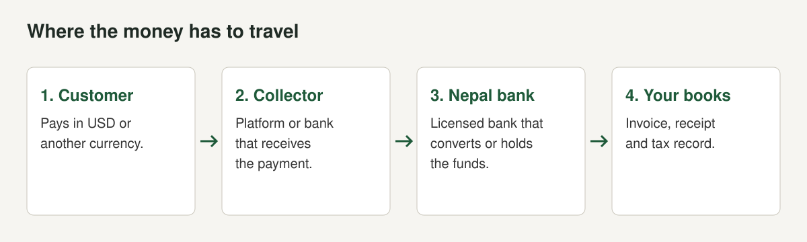
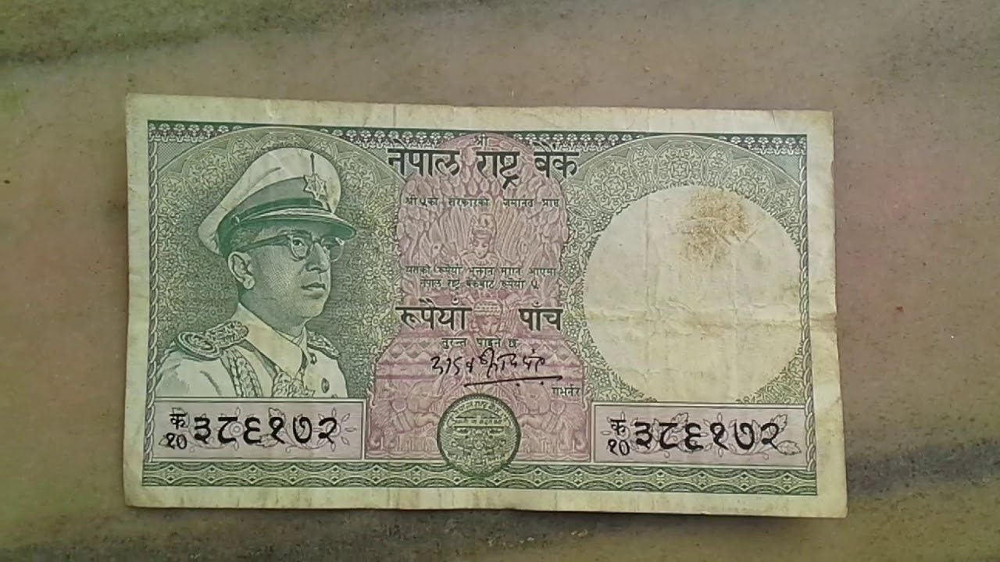

Getting paid is the first practical problem for a Nepali software company that sells abroad. The code can be excellent and the customer eager, and the money still has to arrive in a Nepali bank account in a way the bank, the central bank and the tax office accept.

This guide lays out the routes we could verify, with the fees that providers publish. We opened a bank's inward remittance schedule, Payoneer's fee page, Wise's NPR help page, Khalti's and eSewa's tariff pages, Stripe's Atlas page and the news reports on the Nepal Rastra Bank (NRB) circulars. Where a provider does not publish a fee we say "not published" instead of estimating. We are a software group, not a bank or adviser, and these rules change. This is not legal or tax advice. Check each point with your bank before you rely on it.

## What the rules ask of the route

The route matters as much as the money. The [Kathmandu Post](https://kathmandupost.com/national/2026/02/25/nepal-s-it-exports-near-1-billion-can-the-momentum-be-sustained) quotes NAS-IT's president on why: "payments often come in labelled as remittance" and "it becomes very difficult to distinguish whether the money is payment for IT services or personal remittance". For a company that wants to show export revenue, claim a concession or raise a loan, that mislabelling is a problem. The [tax guide](/blog/software-export-tax-nepal) sets out why proof matters.

Two NRB measures frame what you can do with foreign currency once you earn it.

**Dollar cards for IT.** [Business 360 reported on 6 April 2026](https://www.b360nepal.com/detail/28246/can-federation-welcomes-nrb-directive-to-expand-foreign-currency-access-for-ict-sector) that an NRB circular authorised Class A and national-level Class B banks to issue IT prepaid cards for IT, communication and information broadcasting services.

| Holder | Annual limit | Source | Checked |
|---|---|---|---|
| IT prepaid card, standard | US$3,000 | Business 360, NRB circular | October 2026 |
| Exporting IT entity | US$5,000 | Business 360, NRB circular | October 2026 |
| Larger IT company with significant foreign earnings, online software and infrastructure | Up to US$100,000 | Business 360, NRB circular | October 2026 |
| Individual freelancer earning foreign income | Up to US$25,000 | Business 360, NRB circular | October 2026 |
| Previous limit on standard dollar cards | US$500 | Business 360 | October 2026 |

The same article says the CAN Federation advises IT professionals and businesses to update KYC records, keep clear documentation of foreign currency earnings to qualify for higher limits, and obtain a PAN for any foreign currency demand over US$5,000. It adds that industry groups still want integration of international payment gateways on their agenda.

**Foreign currency facilities for exporters.** [Sharesansar reported on 8 August 2023](https://www.sharesansar.com/newsdetail/foreign-exchange-facilities-for-it-and-service-exporting-businesses-in-nepal-2023-08-08) that NRB's Foreign Exchange Management Department amended its integrated directives so industries and businesses exporting IT and other services can open contact offices abroad, transfer funds to foreign bank accounts and buy software, programs and equipment in foreign currency, through commercial banks, up to 10% of the previous year's foreign currency earnings. The article says exporters must submit audited statements showing the previous year's foreign currency earnings and bank details showing conversion, that a separate approval is needed to open foreign accounts, that the facility is capped at 20% of the taxable income shown in the previous year's tax payment certificate, and that the relevant body's approval is needed (checked October 2026). It may have been superseded by later circulars. For investing abroad, see the 2025 rules in [Nepal's IT export boom](/blog/nepal-it-export-products).

## The routes, with published fees

| Option / provider | What it covers | Fee | Source | Checked |
|---|---|---|---|---|
| Bank SWIFT transfer, Nepal Bank Limited | Crediting an inward remittance to a customer account in NPR or foreign currency | Free. Charges applicable if the correspondent bank charges NBL | [NBL schedule](https://nepalbank.com.np/digital/service-charge/remittance) | October 2026 |
| NBL, forwarding an inward remittance to another bank (foreign currency) | Moving funds on to an account at another bank | 0.20% or minimum US$10 or equivalent, plus NPR 1,000 SWIFT charge | NBL schedule | October 2026 |
| NBL, follow-up by SWIFT at customer request | Tracing a payment | NPR 750 per message, plus other bank charges and NPR 1,000 SWIFT charge | NBL schedule | October 2026 |
| NBL, return of an inward remittance in foreign currency | Sending money back | Up to US$100: 10% of the equivalent or US$20. Above US$100: US$20 or equivalent, plus other bank charges and NPR 1,000 SWIFT charge | NBL schedule | October 2026 |
| NBL, credit advice to customer | The bank's record of the credit | Free | NBL schedule | October 2026 |
| Payoneer, receive via a local-currency receiving account | Customer pays into a local-currency account you hold | Free | [Payoneer fees](https://www.payoneer.com/legal/fees/) | October 2026 |
| Payoneer, receive via a non-local-currency receiving account | Customer pays into an account in another currency | 1% (minimum US$1 or equivalent) | Payoneer fees | October 2026 |
| Payoneer, receive from a payer's credit card | Card payment | Up to 3.99% plus US$0.49 or equivalent | Payoneer fees | October 2026 |
| Payoneer, receive from a payer's EU or UK bank account, or US ACH | Bank debit | 1% | Payoneer fees | October 2026 |
| Payoneer, receive from another Payoneer balance | Payoneer to Payoneer | Free | Payoneer fees | October 2026 |
| Payoneer, withdraw to a bank account in the recipient's local currency without conversion, or with conversion | Moving funds out of Payoneer | 1.2% to 4%. In some countries a minimum fee of up to US$20 applies | Payoneer fees | October 2026 |
| Payoneer, move between your balances | Currency conversion inside Payoneer | 0.50% | Payoneer fees | October 2026 |
| Wise, receive NPR as a Nepali business | Customer pays a Nepali business | Not available: Wise says you cannot send NPR to businesses in Nepal | [Wise NPR help](https://www.wise.com/help/articles/2932337/npr-transfers) | October 2026 |
| PayPal | Customer pays by PayPal | Not operating in Nepal | [Nepali Telecom](https://nepalitelecom.com/paypal-in-nepal) | October 2026 |
| Stripe Atlas | Incorporates a US company, then a US bank account and payments | US$500 for incorporation | [Stripe Atlas](https://stripe.com/atlas) | October 2026 |
| eSewa and Khalti merchant gateways | Domestic wallet payments for Nepali customers | Merchant fees not published on the tariff pages we opened | [eSewa tariffs](https://blog.esewa.com.np/esewa-tariffs), [Khalti charges](https://Khalti.com/info/charges/) | October 2026 |

How to read the table.

**The NBL rows** are one bank's schedule, which we opened. We did not find the equivalent schedules for other banks, so use these rows as a model of what to ask for, not as a Nepal-wide price. The first row is the important one: crediting an inward remittance is free at this bank. The cost sits elsewhere in the chain, in the correspondent bank's charge, in the sender's own bank fee, and in the exchange rate. None of those is on the schedule, so ask.

**The Payoneer rows** come from Payoneer's global fee page. The page says "Fees depend on sender and recipient locations, payment method, and currencies" and that the withdrawal list for "a bank account in the same country as yours, in local currency" does not include Nepal. A withdrawal to a Nepali bank in NPR is a currency-conversion case and falls under the 1.2% to 4% row, but only your Payoneer account shows the exact fee. Payoneer also says full fee details are visible after signing in. [Merokalam's April 2026 guide](https://merokalam.com/blog/payoneer-card-in-nepal/) says Payoneer is the most used route among Nepali freelancers and estimates about 2% conversion on USD withdrawals, which is the blog's estimate and sits inside the official range. Payoneer's own page does not confirm that figure or its Nepal availability.

**The Wise row** is a limit, not a fee. Wise's help page says you can send NPR to any bank account in Nepal, but "you can't send NPR to businesses in Nepal", and that Nepal cannot be the transaction origin country. A Nepali company cannot rely on a customer paying it in NPR through Wise. Do not assume the customer can send USD to your bank by Wise either. Ask Wise.

**The PayPal row.** The report says NRB's deputy governor, Bam Bahadur Mishra, confirmed on or before 20 February 2025 that the bank had sought to connect with PayPal and had asked Fonepay and Standard Chartered Bank to contact it, adding that Nepal–India international payment had started and NRB wanted multiple countries through a single platform. We found no confirmed launch.

**The Stripe row** covers incorporation of a US company. Stripe's global page says Atlas incorporates "a US company from anywhere in the world" and opens a US bank account, accepts payments and supports fundraising. It does not say whether payouts to a Nepali bank account work, so we cannot say. A Nepali company investing abroad is subject to NRB approval, and the [Pioneer Law outward investment handbook](https://pioneerlaw.com/wp-content/uploads/2026/06/Outward-Foreign-Investment-from-Nepal-Regulatory-Handbook-Pioneer-Law-Associates.pdf) describes an NRB route for registered IT companies to invest up to US$20,000 without the usual three-year earnings history, applied for at the NRB's Foreign Exchange Facilitation Unit. Creating a foreign entity has tax and legal consequences in both countries. Take advice first.

**The domestic gateway row.** eSewa's tariff page, last updated Bhadra 3, 2083, lists consumer charges such as Rs 10 for bank withdrawals and Rs 10 per send-money transaction beyond free limits. Khalti's charges page lists 3% on domestic card loads and 5% on international card loads, charged to the customer, and Rs 5 or Rs 10 per transaction for payment from its gateway, without saying who bears that charge. Neither page gives a merchant discount rate. Ask each provider for a written merchant quote.

## What a freelancer guide adds, and how far to trust it

[Merokalam's April 2026 guide](https://merokalam.com/blog/payoneer-card-in-nepal/) is a blog written for freelancers, not an official source, and it makes several claims about Nepali law that we could not verify, so we do not repeat them. Its practical points about the Payoneer setup are worth testing with your own bank:

- The name on the Payoneer account must match the name on the Nepali bank account you link for withdrawals, and a small mismatch such as an initial against a full name can cause withdrawal failures.
- Payoneer verifies the linked bank account with a small deposit, which the guide says arrives within one to three business days.
- Not every Nepali bank branch has its own SWIFT code. Some use the head office code, so confirm the right code with your bank.
- For larger amounts from direct clients, compare a direct SWIFT transfer against the Payoneer route, because the Payoneer conversion fee may be avoided by a SWIFT payment. The guide puts the crossover at above US$2,000, which is its own rule of thumb.

For a company, the bigger point is to receive into a company account, not a personal one, so that the receipt matches your invoice and your books.

## Wise's limits in detail

Wise's NPR help page gives the limits that apply when someone sends NPR to a person in Nepal: up to NPR 1 million per transfer and a daily limit of NPR 2 million per recipient and per sender, with Real Time transfers arriving within about 15 minutes for banks that support them and conversion taking up to two working days otherwise. The page also says you can add NPR to a Wise account only by converting another currency held with Wise, and not from a bank account or other external payment method. All of that concerns individuals receiving NPR. It does not describe a way for a Nepali business to receive.

## Choosing a route

The right route depends on who pays you.

| Customer pays | Best fit | Watch for |
|---|---|---|
| A large foreign company, by invoice, larger amounts | Bank SWIFT to your Nepali account | Correspondent bank and sender bank charges, the bank's exchange rate, days to arrive |
| A marketplace or platform that pays through Payoneer | Payoneer | Marketplace-specific fees, conversion on withdrawal |
| Many small card payments for a subscription | A card processor. We could not verify which accept Nepali businesses | Whether the processor supports your country and your payout route |
| A Nepali customer | A local wallet, QR or bank transfer | Merchant fee in the agreement |

For subscriptions to foreign customers by card, we have no verified answer. Asking a processor "do you accept businesses registered in Nepal and pay out to a Nepali bank?" before you build the billing screens will save weeks.

## Questions to put to your bank

Write the answers down, because they decide your net price.

1. What do you charge to credit an inward SWIFT payment to a foreign-currency account, and to a rupee account?
2. What exchange rate do you apply, and how does it compare with the NRB rate on the day?
3. Which documents do you need for each receipt: invoice, contract, purpose code?
4. How long from the sender's bank to my account, on average?
5. Will you issue a credit advice that I can attach to the tax record? (NBL's schedule lists a credit advice as free.)
6. Under the NRB circular, what dollar card limit applies to my company, and what documents raise it?
7. What do you need from me to apply for any NRB exporter facility?

## How to compare real cost

Ask for three numbers in writing on a US$1,000 payment: the receiving fee, the conversion margin against the market rate on the day, and the final bank charge. Add them and divide by the payment. Then compare the days from the customer's payment to usable money. Add the intermediary charge that the sender's bank takes, which only the sender can tell you. A route that is cheaper on the fee page can cost more once conversion and delay are counted.

## Mistakes we see

- **Choosing the route after pricing the product.** The fee and delay are part of the price.
- **Letting customers label payments as remittance.** It cannot then be shown as export income, and a bank may ask questions.
- **Assuming PayPal will arrive.** NRB approached it in February 2025. Build for what works now.
- **Relying on Wise from the customer side without asking.** Wise's page says it cannot send NPR to Nepali businesses.
- **Quoting a net price without the correspondent bank charge.** The NBL schedule itself says charges apply if the correspondent bank charges.
- **Not keeping the bank credit advice.** Pair it with the invoice and contract.
- **Taking a card limit for granted.** The 2026 circular raised limits for IT, but a higher limit needs the right documents with your bank.

## A checklist

- [ ] Company registered and bank account opened. See [how to register a software company in Nepal](/blog/register-software-company-nepal).
- [ ] Two banks asked the seven questions above, in writing
- [ ] One real payment sent through the chosen route and timed
- [ ] Fee, conversion margin and days recorded
- [ ] Invoice, contract and bank credit advice stored together
- [ ] Dollar card limit and documents checked for tools you buy abroad
- [ ] Merchant quotes obtained from local gateways if you sell in Nepal
- [ ] Tax treatment checked for the route. See [tax on software exports from Nepal](/blog/software-export-tax-nepal)

The whole chain, from registration to hosting and law, is in [building SaaS in Nepal](/blog/building-saas-in-nepal), and the wider export picture is in [Nepal's IT export boom](/blog/nepal-it-export-products).

## The short version

- A bank SWIFT transfer is the baseline. At Nepal Bank Limited, crediting an inward remittance is free unless the correspondent bank charges.
- Payoneer's published rates run from free to 1% to receive and 1.2% to 4% to withdraw with conversion. Nepal is not listed separately.
- Wise cannot send NPR to businesses in Nepal. PayPal is not operating in Nepal.
- NRB's April 2026 circular raised IT dollar card limits to US$3,000, US$5,000 for exporters and up to US$100,000 for larger IT companies.
- Test one real payment before you price, and keep invoice, contract and bank record together.

*This post is not legal or tax advice. Confirm current rules and fees with your bank and the provider.*
