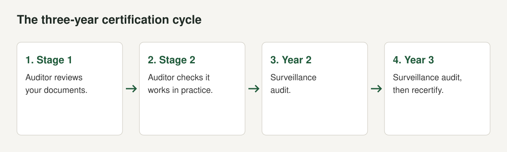

Sooner or later a bank, a tender document or a large customer asks a Nepali software company: "Are you ISO 27001 certified?" For most small teams the honest answer is no, and the next question is whether they should be. This post explains what the certificate is, who in Nepal holds one, what the published prices look like, and how we would decide.

A note on the evidence. We opened certification-body and consultancy pages, press reports of Nepali certifications, a KPMG summary of the 2022 revision, Pioneer Law's brief on the data centre and cloud directive and a Nepali bank's request for quotation. We found no published price list from any certification body working in Nepal, so the figures below are from Irish and UK pages and we say so. We have not certified our own products, so this is research, not a diary. It is not legal or compliance advice.

## What ISO 27001 certifies

ISO/IEC 27001 is a standard for an information security management system (ISMS): the policies, risk assessments, controls and routines an organisation uses to protect information. An independent certification body audits you against it. The certificate covers the scope you choose. It is not a certificate for a product and it does not promise you will never be breached.

[KPMG's summary of the 2022 revision](https://assets.kpmg.com/content/dam/kpmg/uk/pdf/2023/08/isoiec-27001-2022.pdf), which we opened, gives the facts that matter for planning (checked October 2026):

- ISO published the new version at the end of October 2022.
- Annex A went from 114 controls in 14 sections to 93 controls in four: People, Technological, Physical and Organizational.
- 11 controls are new, 57 were merged, and 23 were renamed. New controls include threat intelligence, information security for use of cloud services, ICT readiness for business continuity, physical security monitoring, configuration management, information deletion, data masking, data leakage prevention, monitoring activities, web filtering and secure coding.
- Four new requirements were added to clauses 4 to 10, and no significant requirement from 2013 was removed.
- KPMG describes a transition deadline of October 2025 for organisations certified against the 2013 version, so any new certificate today is against the 2022 version.

Several of the new controls (cloud services, secure coding, information deletion) read like a software company's daily work, which is one reason the standard suits software teams.

## Who in Nepal holds it

We found only large organisations. None of the pages we opened named a Nepali software product company.

| Organisation | Standard and certifier | Date | Source |
|---|---|---|---|
| NMB Bank | ISO 27001:2013, TUV Rheinland, reported as the first bank in Nepal | December 2019 | [Sharesansar](https://www.sharesansar.com/newsdetail/nmb-becomes-first-bank-in-nepal-to-receive-iso-270012013-certification-from-tuv-rheinland) |
| Sun Nepal Life Insurance | ISO/IEC 27001:2022, Amtivo Limited, UK, recognised by UKAS | October 2024 | [Sharesansar](https://www.sharesansar.com/newsdetail/sun-nepal-life-insurance-awarded-isoiec-27001-2022-certification-for-information-security-2024-10-18) |
| Nabil Bank | ISO 27001:2022, INTERCERT | January 2025 | [OnlineKhabar](https://english.onlinekhabar.com/nabil-bank-receives-iso-270012022-certification-for-robust-information-security-management.html) |
| Ncell | ISO 27001:2022 and ISO 27701:2019 for its data centre, customer service and IT services | Undated press release | [Ncell](https://www.ncell.com.np/en/about/media-room/press-release/ncell-is-the-first-nepali-telecom-company-to-receive-iso-27001-and-iso-27701-certifications-for-information-security-and-data-privacy) |

Two things stand out. The certificates come from foreign certification bodies, so a Nepali firm will usually deal with an overseas auditor, plus travel and time-zone logistics. And the scopes are specific: Ncell's covers its data centre, customer service and IT services, not the whole company. Scope is the first lever you control.

NIC Asia Bank's [request for quotation](https://cms.nicasiabank.com/framework/uploads/Notice/2025/ISO%20Migration%20_3X18.pdf), with a deadline of 9 October 2025, shows how the local market is organised. The bank sought quotations from firms for ISO/IEC 27001:2022 consulting and certification services, with a non-refundable document fee of NPR 1,000. Applicants needed experience of ISO/IEC 27001:2022 consulting and certification services in at least three Nepali organisations, annual turnover of at least NPR 5 million in the latest year, and authorisation letters from certification bodies. In other words, local consultancies work with foreign certification bodies. The NPR 1,000 is the price of the tender document, not of certification.

## Why it may matter to a Nepali software company

**If you host for others.** [Pioneer Law's brief on the Data Centre and Cloud Services Directive, 2081](https://pioneerlaw.com/wp-content/uploads/2025/03/Data-Centre-and-Cloud-Services-Operation-and-Management-Directive-2081-–-Brief.pdf) says that data centres are required to provide an Information Security Standard certificate for both the data centre and disaster recovery site, and that cloud services must submit an Information Security Related Standard certificate and an Information Technology Service Management Standard certificate, as part of enrolment with the Department of Information Technology. We could not open the directive's own text, and the brief does not name ISO 27001, so we do not claim the directive requires that specific standard. See [our reading of the directive](/blog/nepal-data-center-cloud-directive-2081).

**If you sell to payments, banks or government.** DLA Piper's guide notes that licensed payment institutions may only host their data centres with entities listed by the Department of Information Technology under the Payment Systems-Related Unified Directives. Buyers like these ask about security. See [selling software to Nepal's government](/blog/selling-software-to-government-nepal).

**If you hold personal data.** The Privacy Act asks public bodies to protect personal information and bars use without consent. See [the Privacy Act and apps](/blog/individual-privacy-act-2075-apps). A certificate is not a defence, but it is evidence that you run security as a process.

**If you export.** Foreign buyers often send security questionnaires. See [Nepal's IT export boom](/blog/nepal-it-export-products).

## What the 2022 controls ask of a software team

KPMG's summary lists the new 2022 controls, and several describe ordinary software company work:

| Control | Topic | What it means in a software company |
|---|---|---|
| A.5.7 | Threat intelligence | Someone watches for threats relevant to your stack and records what they decide |
| A.5.23 | Information security for use of cloud services | A written approach to the cloud providers you rely on |
| A.5.30 | ICT readiness for business continuity | Tested backups and recovery plans |
| A.7.4 | Physical security monitoring | Office and server room monitoring, if in scope |
| A.8.9 | Configuration management | Infrastructure and settings tracked and reviewed |
| A.8.10 | Information deletion | Deleting data when it is no longer needed. This also matches [the Privacy Act's purpose limit](/blog/individual-privacy-act-2075-apps) |
| A.8.11 | Data masking | Hiding sensitive fields in test and support tools |
| A.8.12 | Data leakage prevention | Controls against data leaving by mistake or by intent |
| A.8.16 | Monitoring activities | Logs and alerts that someone reads |
| A.8.23 | Web filtering | Controls on what staff devices can reach |
| A.8.28 | Secure coding | A secure development practice with review |

The first two columns come from KPMG's list. The third column is our reading. The standard does not tell you how to meet each control. It asks you to assess risk and choose controls that fit, then to show the auditor they run.

## Choosing a certification body

Amtivo's guide gives three questions worth putting to any body:

1. **Is it accredited by a national accreditation body?** Amtivo says accredited bodies are subject to rules that non-accredited bodies are not, and that accredited certificates are accepted worldwide through the IAF's arrangement. Non-accredited bodies, it says, can tie you into long-term contracts.
2. **Will it quote in writing for free?** Amtivo says accredited certification bodies do not charge for a quotation.
3. **Who audits, from where?** Nepali organisations such as NMB Bank, Sun Nepal Life and Nabil Bank used bodies from Germany, the UK and elsewhere, so ask about travel, language and remote Stage 1 options.

## The process

The guides we opened describe the same path (High Table, a UK consultancy that sells toolkits, so read its cost advice with that in mind):

1. **Set the scope.** High Table advises focusing certification on the specific products, services or hosting environments your enterprise customers care about, which reduces audit days.
2. **Prepare.** Buy the standards (about GBP 150 each for ISO 27001 and ISO 27002 per High Table, and Amtivo's guide puts the standard at around EUR 137) and decide whether to run a gap analysis.
3. **Implement.** Write policies, run a risk assessment and put controls in place. High Table lists a do-it-yourself toolkit route of 30 to 90 days at about GBP 500, and consultant routes of 6 to 12 months.
4. **Internal audit.** High Table calls this mandatory before certification.
5. **Stage 1 audit.** Documentation review.
6. **Stage 2 audit.** Testing the controls in operation.
7. **Certificate, then surveillance.** Amtivo describes a three-year certification cycle of annual audits, shorter than the initial audit because they assess ongoing maintenance. High Table says full recertification is required every three years.

## Published prices

None of these is a Nepali quote. They show the scale.

| Option / provider | What it covers | Fee | Source | Checked |
|---|---|---|---|---|
| Amtivo (Ireland, INAB-accredited) | Initial certification, business with fewer than 10 staff at one location | EUR 4,500 to EUR 7,000 | [Amtivo](https://amtivo.com/ie/resources/insights/how-much-does-iso-27001-certification-cost/) | October 2026 |
| Amtivo | The ISO 27001 standard document | Around EUR 137 | Amtivo | October 2026 |
| High Table audit-day calculator (UK, GBP 1,250 a day) | Certification audit, 1 to 10 employees, 5 audit days | GBP 6,250 | [High Table](https://hightable.io/how-much-does-iso-27001-cost) | October 2026 |
| High Table | 11 to 15 employees, 6 audit days | GBP 7,500 | High Table | October 2026 |
| High Table | 16 to 25 employees, 7 audit days | GBP 8,750 | High Table | October 2026 |
| High Table | 26 to 45 employees, 8.5 audit days | GBP 11,250 | High Table | October 2026 |
| High Table | 46 to 65 employees, 10 audit days | GBP 12,500 | High Table | October 2026 |
| High Table | Annual surveillance audit, years 1 and 2 | About 33% of the initial certification fee | High Table | October 2026 |
| High Table | Recertification in year 3 | About 100% of the initial assessment cost | High Table | October 2026 |
| High Table | Independent internal audit | GBP 3,500 to GBP 10,000 | High Table | October 2026 |
| High Table | Do-it-yourself toolkit | About GBP 500 | High Table | October 2026 |
| High Table | Traditional consultant for implementation | GBP 5,000 to GBP 40,000 | High Table | October 2026 |
| NIC Asia Bank RFQ | Document fee to bid for consulting and certification work | NPR 1,000, not a certification price | [NIC Asia RFQ](https://cms.nicasiabank.com/framework/uploads/Notice/2025/ISO%20Migration%20_3X18.pdf) | October 2026 |

Notes on reading the table.

- High Table says that in 2026 the average cost in the UK reached GBP 1,500 per auditor day, a 20% increase over 2025, which is above the GBP 1,250 its calculator uses. Its calculator is therefore a floor on its own reasoning.
- The audit-day count follows ISO/IEC 27006-1:2024 and is driven by headcount, according to High Table.
- Amtivo says accredited certification bodies do not charge for providing a quotation, and that non-accredited bodies are not subject to accreditation rules and can tie you into long-term contracts. Ask for at least three written quotes. High Table says the same.
- High Table is a vendor of toolkits and consulting. Amtivo is a certification body. Both are describing their own markets. We did not find a Nepal price list, so ask for quotes in rupees and ask who bears travel.

## What it costs besides the audit

High Table's list of costs beyond the audit is worth taking seriously.

- **Training.** ISO 27001 lead auditor or implementer courses about GBP 2,500, and staff security awareness about GBP 50 per employee.
- **Internal time.** High Table calls internal resource cost the biggest hidden expense, because staff spend less time on revenue work.
- **Tools.** Recurring platform fees if you buy a compliance tool.
- **Dedicated staff.** A full-time internal ISMS owner at GBP 40,000 to GBP 60,000 a year, or an external consultant at GBP 12,000 to GBP 36,000 a year, per High Table. Those are UK salaries and fees, and for a small Nepali team we expect a part-time owner, but we did not find a Nepali figure.

## How long it takes

High Table says the entire process usually takes about six months, and lists 30 to 90 days for the toolkit route and 6 to 12 months with a consultant. The audit itself is a few days. The rest is your team's time.

## When it is worth it

We would decide with five questions.

1. **Has a customer, tender or regulator asked for it?** A real request is the strongest reason.
2. **Do you host others' data?** If so, the directive's certificate requirement bears on you.
3. **Can you afford the hours?** Count engineer time, not only the fee.
4. **Is the scope narrow enough to be honest and affordable?** A scope that covers one product and one hosting environment is cheaper and easier to defend.
5. **Would a smaller step do the job?** A written security baseline, access control with multi-factor sign-in, backups you have restored, a patching routine and an incident plan answer many questionnaires. The 2022 controls are a useful checklist even if you never certify.

If the answers are no, no, no, yes and yes, do the smaller step and revisit when a deal depends on it. If a large customer or the directive asks, plan the certification and fund it as a cost of selling.

## Doing it cheaply

- Keep the scope to the product you sell.
- Reuse what you already do. Code review, backups and access control count once documented.
- Pick the auditor after you have three quotes, in rupees, with travel stated.
- Use a toolkit or templates if they help, but do not buy a platform in place of doing the work. High Table warns against overspending on recurring SaaS platforms and high-priced consultants without assessing the need, and it sells toolkits, so apply your own judgement.

## Mistakes we see

- **Certifying the whole company when one product is what buyers ask about.**
- **Choosing a body by price alone.** Check the body's accreditation. Amtivo's guide says accredited certification gives you a certificate accepted worldwide through the IAF arrangement.
- **Writing policies nobody follows.** Auditors test operation in Stage 2.
- **Forgetting year two and three.** Surveillance audits and recertification are real costs.
- **Using the 2013 version.** The October 2025 deadline has passed.
- **Letting the owner be the only person who understands it.**

## A checklist

- [ ] A buyer, tender or directive asks for it, or you decided you want it
- [ ] Scope written down in one paragraph
- [ ] Three written quotes in rupees, with travel stated
- [ ] 2022 standard bought and read
- [ ] Gap analysis done, owner named
- [ ] Risk register, policies and records written and in use
- [ ] Internal audit completed
- [ ] Stage 1 and Stage 2 booked
- [ ] Surveillance audits for years two and three budgeted

The wider groundwork for a Nepali SaaS business is in [building SaaS in Nepal](/blog/building-saas-in-nepal).

## The short version

- ISO 27001:2022 has 93 controls in four groups. The 2013 version's transition deadline was October 2025.
- Published prices we could open are Irish and UK: EUR 4,500 to EUR 7,000 for a business under 10 staff (Amtivo), and about GBP 6,250 for 5 audit days at 1 to 10 employees (High Table). We found no Nepali price list.
- Nepali banks and an insurer hold certificates from foreign certification bodies. The directive's brief says providers must submit information security certificates.
- Certify when a buyer, tender or the directive asks. Until then, write and test a security baseline.

*This post is not legal or compliance advice. Cost figures are from Irish and UK pages, not Nepali quotes.*
