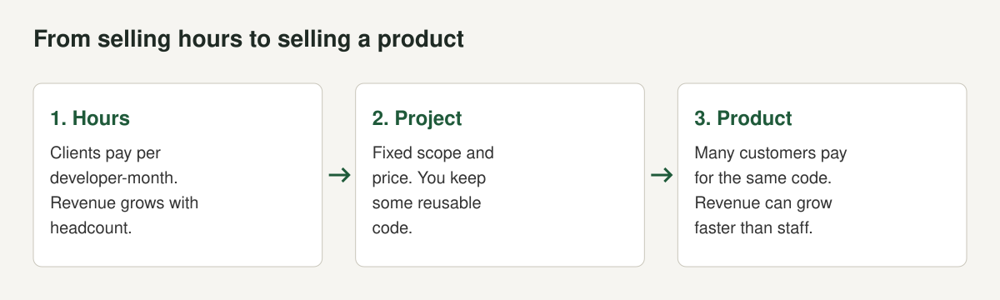

Nepal has a real software export trade and does not measure it well. Ask the people who run it for the number and you will hear "about a billion dollars", followed by an admission that nobody can prove it. That honesty is the first useful fact in this post.

We are Ninja Infosys, a product company in Kathmandu. We build AirFone, ePahichan, LunaCam, eShasan and LunaIoT. We have no inside numbers on the sector and we are one small team in it. What we do have is the product builder's view: what changes when a team stops selling hours and starts selling software that many customers pay for. This post sets out what the published figures say, how they disagree, which policies now exist, and what a team needs in place to build a product for export. Every figure below comes from a page we opened, and we link it. Where sources conflict we say so.

## How big are Nepal's IT exports?

The number in circulation is about US$1 billion for 2025. The [Kathmandu Post reported it on 25 February 2026](https://kathmandupost.com/national/2026/02/25/nepal-s-it-exports-near-1-billion-can-the-momentum-be-sustained) and the detail in that report matters more than the headline (checked October 2026).

The estimate comes from the Nepal Association for Software and IT Services (NAS-IT), which describes it as a "best estimate". The last comprehensive study was done in 2022 by the Institute for Integrated Development Studies (IIDS) and put ICT exports at about US$515 million. The newer figure applies an average growth rate of around 20% a year, which industry leaders say reflects current market trends. At that rate the Post calculates the total would approach US$900 million to US$1 billion after three years. NAS-IT's president, Gaurav Pandey, said survey data would be available by the end of the year and that the figure for now "is based on industry growth patterns and multiple informal assessments".

[Bangladesh Monitor](https://www.bangladeshmonitor.com.bd/en/nepals-it-service-exports-reach-estimated-usd-1-billion-annually-industry-s) reported the same estimate in rupees, NPR 145 billion, and said the 2022 IIDS study had placed exports at NPR 67 billion (checked October 2026).

| Measure | Figure | Source | Status |
|---|---|---|---|
| IT service exports, 2022 | US$515.4 million (NPR 67 billion) | IIDS study, as reported by [Business 360](https://www.b360nepal.com/detail/27700/inside-nepals-quiet-software-export-boom-and-what-it-needs-to-go-global) and Bangladesh Monitor | Last full study |
| Growth in 2022 | 64.2% over the year | IIDS, as summarised by [Pioneer Law](https://pioneerlaw.com/?p=1189) | Study |
| Share of GDP, 2022 | About 1.4% | Business 360, Pioneer Law | Study |
| Share of foreign exchange reserves, 2022 | About 5.5% | Business 360, Pioneer Law | Study |
| IT service exports, 2025 | About US$1 billion (NPR 145 billion) | NAS-IT via Kathmandu Post and Bangladesh Monitor | Industry estimate |
| People employed | About 100,000 (more than 70,000 in the 2022 IIDS survey) | NAS-IT via Kathmandu Post | Industry estimate |
| Concentration | 90% of IT employment in Kathmandu | NAS-IT via Kathmandu Post | Industry estimate |

Business 360 adds two comparisons. IT exports in 2022 were nearly three times the value of refined soybean oil, then Nepal's top merchandise export, and they exceeded earnings from carpets and textiles. Pioneer Law's summary of the IIDS report counts 14,728 freelancers in software development and technology and 51,781 freelancers in IT-enabled services engaged in IT service exports in 2022.

One more number needs a warning. [Outsource Accelerator](https://news.outsourceaccelerator.com/nepal-it-exports-1bn/) reports more than 6,000 BPO firms operating in the country, citing Asia News Network. The same article says more than 100 companies process Australian home loans. We could not find a primary count of firms, so we treat 6,000 as an unverified headline.

## Why the number is invisible

The reason the sector is "quiet" is statistical, not mysterious. Pandey told the Post that "payments often come in labelled as remittance" and that it "becomes very difficult to distinguish whether the money is payment for IT services or personal remittance". Because clients abroad frequently mark transfers simply as remittances, industry bodies rely on extrapolations instead of central bank data.

Business 360 quotes Pandey putting it more directly: "The income is legal, but it's misclassified." It also reports that freelancers and small firms often receive foreign payments as remittances to avoid complex regulatory and tax compliance, which masks the sector's true size.

This matters to a company for practical reasons. Income labelled as remittance cannot be shown as export revenue. It is harder to show a buyer, a bank or an investor. And it makes it harder to claim any concession that depends on proving an export. We come back to this in the payments and tax guides.

## What the government wants

The state has set a large target. [Pioneer Law's summary of the 2024/25 budget](https://pioneerlaw.com/?p=1189) says the decade 2081 to 2091 BS was declared the "Decade of Information Technology", aiming to export IT services worth NPR 3 trillion and generate 1.5 million direct and indirect jobs (checked October 2026). Business 360 converts the same target to US$22.5 billion over ten years and reports 500,000 direct jobs. Bangladesh Monitor reports a target of US$22 billion in cumulative exports and 500,000 new jobs. The sources disagree on the jobs figure and none of them gives a statute number, so treat the job target as uncertain.

Business 360 also quotes industry leaders who consider US$5 to 6 billion by 2034 a realistic intermediate milestone. That is an opinion, not a forecast, but it shows how far the official target sits from what the industry itself plans around.

In 2023 the government recognised information technology as a priority export in the Nepal Trade Integration Strategy, according to Business 360, by which time the sector was already well underway.

## The policy stack that exists today

For a company the useful question is not the target but the rules. These are the ones we could verify in primary or near-primary sources.

### Income tax

[Section 11(3E)(c) of the Income Tax Act, 2058](https://nepallaws.com/Laws/income-tax-act-2058-2002/chapter-4-exemptible-amounts-and-other-exemptions/section-11-professional-exemptions-and-facilities/) provides that if a person earns foreign currency by exporting information technology-based services such as business process outsourcing, software programming and cloud computing, they "will be taxed up to fifty percent of the income earned in foreign currency up to the year 2084/85" (checked October 2026). The same section gives other IT-relevant reductions. Under section 11(3)(a), a special industry or information technology industry that gives direct employment to 100 or more Nepali citizens throughout the year pays 90% of the normal rate of tax, with deeper reductions at 300, 500 and 1,000 employees. Section 11(3C) gives a 50% exemption to software development and data processing businesses operating in a designated technology or IT park.

Budgets have layered announcements on top. [Alpine Law Associates](https://lawalpine.com/blog/budget-2082-83-tax-changes-in-nepal) reports a 75% exemption on IT export earnings for 2082/83, "producing an effective rate around 5%", and [the same firm's 2083/84 summary](https://lawalpine.com/blog/budget-2083-84-tax-changes-in-nepal) reports the exemption reset to 50% from 75%, plus a 100% exemption for IT sweat equity (checked October 2026). [Business 360](https://www.b360nepal.com/detail/29119/nepals-it-budget-208384) also reports a 50% income tax exemption for IT service exports in the 2083/84 budget. Our [tax guide](/blog/software-export-tax-nepal) sets out what we could and could not confirm. NAS-IT's own complaint is the instability: "Tax rates change every year. We need stability for at least 10 to 15 years."

### VAT

Schedule 2 of the VAT Act, 2052 lists services supplied to persons outside Nepal as zero-rated. [Item 2](https://nepallaws.com/Laws/value-added-tax-act-2052/schedule-2-relating-to-sub-section-2-of-section-7/goods-and-services-subject-to-zero-rate/) covers a supply of services by a person residing in Nepal to a person outside Nepal who has no business transaction, business representative or legally recognised agent in Nepal, and a supply of goods or services by a registered resident to a person residing outside Nepal (checked October 2026).

### Foreign currency access

The Nepal Rastra Bank (NRB) has eased IT-specific access to dollars. [Business 360 reported on 6 April 2026](https://www.b360nepal.com/detail/28246/can-federation-welcomes-nrb-directive-to-expand-foreign-currency-access-for-ict-sector) that Class A and national-level Class B banks may issue IT prepaid cards for IT, communication and information broadcasting services with an annual limit of US$3,000, rising to US$5,000 for exporting IT entities. Larger IT companies with significant foreign earnings can pay up to US$100,000 a year for online software and infrastructure, and individual freelancers with foreign income up to US$25,000. The article says the previous US$500 limit on standard dollar cards had pushed many businesses and developers toward informal payment channels (checked October 2026).

An earlier change, [reported by Sharesansar on 8 August 2023](https://www.sharesansar.com/newsdetail/foreign-exchange-facilities-for-it-and-service-exporting-businesses-in-nepal-2023-08-08), allowed IT and service exporters to open contact offices abroad, transfer funds to foreign bank accounts and buy software and equipment in foreign currency, up to 10% of the previous year's foreign currency earnings, on submission of audited statements and bank records of conversion. It may have been superseded.

### Investing abroad

Nepali IT companies could not invest abroad for decades. [Pioneer Law's outward investment handbook (June 2026)](https://pioneerlaw.com/wp-content/uploads/2026/06/Outward-Foreign-Investment-from-Nepal-Regulatory-Handbook-Pioneer-Law-Associates.pdf) explains that an Investment Facilitation Amendment Act, 2024 updated the Foreign Exchange Regulation Act, 1962 and the Foreign Investment and Technology Transfer Act, 2019, and that NRB bylaws set the procedure. An IT company must first confirm that its business falls within the Industrial Enterprises Act definition of an IT industry, which the handbook lists as including software development, data processing, BPO or KPO, data centres and cloud computing, web design and hosting, and online marketing. The criteria, introduced on 2 June 2025 and relaxed on 11 December 2025, are:

1. The investment may not exceed the company's paid-up capital.
2. The company must have earned foreign currency for at least the last three consecutive years.
3. The investment is the lesser of 50% of average foreign currency earnings over those three years or US$1 million.
4. For investments up to US$20,000, criteria 1 to 3 do not apply.

Applications go to the Foreign Exchange Facilitation Unit at the NRB's One Stop Service Center. The practical point for a product company is the US$20,000 route: it allows a registered IT company to set up a foreign subsidiary or register intellectual property abroad before it has a three-year earnings history.

#### What an outward investment application needs

Pioneer Law's handbook lists the documents the NRB bylaws require, and the list is long enough that a product company should start collecting it before the decision to expand (checked October 2026):

| Item | What it is |
|---|---|
| Registration certificate | Certified copy for the Nepali company |
| PAN certificate | Certified copy |
| Audited financial statements | Most recent fiscal year |
| Tax clearance | Certificate or proof of tax filing for the latest fiscal year |
| Constitutional documents | Certified MOA and AOA |
| OCR updated profile | Latest certified list of shareholders and directors |
| No-overdue declaration | Self-declaration of no non-performing loans in the Nepali banking system |
| Board resolution | Approving the outward investment and exchange facility |
| AML and CFT undertaking | Self-declaration of compliance |
| Beneficiary bank details | Foreign bank name, address and account number. A self-declaration that details will follow is now allowed for new setups |
| CIB report | No "blacklisted" status, issued within the last six months |
| Police clearance | For the ultimate beneficial owners |
| UBO integrity declaration | Age, bankruptcy status, tax compliance and no public office |

The handbook describes a circularity that early applicants hit: the NRB wanted the foreign bank account details, but the foreign subsidiary could only register after NRB approval. The fifth amendment to the NRB bylaws introduced the self-declaration to remove the two-stage filing. Typical approval conditions, which mirror the bylaws, are audited statements of the foreign investment within six months of the end of both the foreign and Nepali fiscal years, and repatriation of all income and any returned amounts through the formal banking system.

Two further points from the handbook matter to a software company. First, the handbook describes technology transfer, defined to include software development, data processing and cloud-based solutions, as a vehicle for offshore equity: a Nepali company that transfers technology to an offshore company can invest earnings from those services in offshore entities. Opening a branch or unit abroad needs prior Department of Industry approval, while investing in a foreign company's shares needs NRB approval. The handbook says the technology transfer route lacks a specific checklist in the bylaws, so the NRB uses discretion. Second, the handbook reports that the 2025 amendment to the Foreign Exchange Regulation Act now permits a foreign parent company, or a sister company, to run an employee stock purchase plan for Nepali citizens employed in Nepal, with a "cashless exercise" so that the employee need not remit foreign currency. Before this, it says, firms used restricted stock units or phantom equity. For a team that wants to hire against foreign multinationals with equity, that is a change worth a conversation with a lawyer.

### Foreign investment into Nepal

Law firm Bhandari reports that a Nepal Gazette notice of 2 October 2023 removed the NPR 20 million minimum foreign investment for IT companies, and that IT is on the positive list of the Industrial Enterprises Act and not on the negative list of foreign investment ([Law Bhandari](https://lawbhandari.com/publication/registration-of-information-technology-(it)-business-in-nepal-through-the-route-of-foreign-direct-investment), checked October 2026).

## What Nepal exports, and who sells it

Business 360 describes Nepal's exports as more varied than low-cost outsourcing: full-stack development, cloud architecture, data analytics, cybersecurity, AI services and long-term product maintenance. The Post lists the mix as software development, IT outsourcing, AI services, US healthcare data analytics and Australian home loan data processing. It names Fusemachines as active in AI services and says "more than a dozen companies" employ thousands of workers in home loan processing.

The most revealing quote on products comes from Pandey in Business 360: "Global clients trust known brands. Nepali firms often build the product, but someone else sells it." The article adds that F1Soft builds international-grade software, but "regulatory barriers force it to sell through third parties who rebrand and export it". And it states plainly that "most exports remain service-based", that services generate steady income while products create scale and intellectual property, and that moving to product-led growth "will require patient capital, legal clarity and international market access, conditions still evolving in Nepal".

That is the gap this post is about.

## What holds growth back, according to the people in it

The Kathmandu Post's report is as much about constraints as about the milestone. It gives a consistent list, and it helps to separate what is a fact from what is an opinion.

- **People and education.** The Post reports that experts say sustaining growth depends on education reform, digital infrastructure and policy stability. A researcher at IIDS, Shreesh Tripathi, said that "without urgent curriculum reform" Nepal's digital ambitions will stall and argued for teaching emerging technologies such as AI at earlier grade levels.
- **Concentration.** NAS-IT says 90% of IT employment is in Kathmandu, which reflects the clustering of colleges, firms and infrastructure in the capital.
- **Diaspora.** Both the NAS-IT president and the IIDS researcher point to returnees who start tech-enabled companies, naming SumX and K&A Engineering as examples of firms founded or led by returnees that serve foreign clients.
- **Foreign investment.** The Post says foreign direct investment remains limited and that industry leaders want stronger incentives and regulatory stability. Pandey cited the early entry of Nabil Bank and Standard Chartered Bank Nepal as examples of how foreign participation transferred skills.
- **Policy stability.** "Tax rates change every year", Pandey told the Post, and he asked for stability of at least 10 to 15 years.
- **Competitive advantages.** Bangladesh Monitor reports industry leaders citing a young population, English proficiency and a time zone that suits markets such as Australia, Japan and Europe. Business 360 says cost matters but is not decisive, and lists adaptability, English proficiency and exposure to global tools as advantages.

Two more details from the Post show where the sector sees its next step. Industry leaders estimate about 100,000 people work in the sector now, against more than 70,000 in the 2022 IIDS survey, and say that if employment grows around 18% a year it could reach 500,000 within a decade. And a digital governance expert quoted in the article argues that Nepal's opportunity "isn't low-wage work, it's AI-enabled services". That is an argument for products and platforms over hours, and it is the one our own work rests on, but it is an opinion, not a measurement.

## Services and products are different businesses

A services company sells capacity. A client owns the result, cash arrives soon after the work, and the main risk is that one or two foreign clients make up most of the income. A product company owns the code and carries the risk that nobody buys it. It spends months before the first customer pays, and in return the same engineering work serves a hundred customers, then a thousand.

Pioneer Law's reading of the 2024/25 budget says the same thing in policy terms. It recommends that Nepal "evolve from exporting IT services to developing and exporting IT products to foster intellectual property development, generate high-skilled jobs, and reduce the sector's reliance on labor arbitrage". It lists four reforms: a product-oriented sector with funding for startups, clear Employee Stock Ownership Plan rules, updated intellectual property law, and flexible outward investment.

Most companies sit between the two. A team does client projects to pay salaries and puts a share of its time into something reusable. That is how many product companies began. The trap is the middle of the path, where client work always has a deadline and the product never does. We wrote about how a group chooses in [choosing what to build next](/blog/choosing-what-to-build-next), about the funding side in [capital allocation for a small group](/blog/capital-allocation-for-a-small-group), and about when to stop in [deciding when to stop a product](/blog/deciding-when-to-stop-a-product).

## What a product company needs that a services company does not

### Intellectual property you can defend

Pioneer Law says the current law, which broadly covers protection for "computer programs", is inadequate for the evolving digital landscape, and that revisions should define IP rights for software, source code, platforms and licensing models. For a product company this means contracts do the work the statute does not. Assign IP in every employment and contractor agreement, keep a clear record of what is yours, and register the company that owns the product where your customers are, which is where the US$20,000 outward investment route helps.

### A way to be paid by many small customers

A product sold abroad needs card payments, subscriptions, refunds and chargebacks. Services firms often have one or two clients who wire money. We cover the routes, limits and published fees in [how to accept international payments as a Nepali software company](/blog/international-payments-nepal-software-company).

### A company that can invoice and claim export treatment

Registration, a PAN, VAT registration where needed and industry registration for IT industry status come before the first foreign invoice. See [how to register a software company in Nepal](/blog/register-software-company-nepal) and the tax treatment in [tax on software exports from Nepal](/blog/software-export-tax-nepal).

### Trust in where data lives and how it is handled

Buyers abroad, banks at home and government offices ask where customer data lives and what you do to protect it. The hosting rules are in [Nepal's data centre and cloud directive](/blog/nepal-data-center-cloud-directive-2081). The privacy duties are in [the Privacy Act and apps](/blog/individual-privacy-act-2075-apps). The question of a security certificate is in [ISO 27001 for Nepali software companies](/blog/iso-27001-nepal-software-company). For the public sector, see [selling software to Nepal's government](/blog/selling-software-to-government-nepal).

### Patient money and a team that can ship the whole thing

The Post's reporting shows that foreign direct investment into tech remains limited, and Pandey argues for FDI companies "for knowledge transfer". On the people side, product work needs someone who decides what to build, someone who tests as a customer would and someone who answers support. We wrote about hiring in [hiring the first ten engineers in Kathmandu](/blog/hiring-first-ten-engineers-kathmandu).

## What the industry is asking for

NAS-IT's asks give a useful list of what is not yet in place. [Bangladesh Monitor](https://www.bangladeshmonitor.com.bd/en/nepals-it-service-exports-reach-estimated-usd-1-billion-annually-industry-s) reports that NAS-IT's treasurer called for a stable 10-year policy framework, a corporate tax rate below 1% for at least a decade and a simpler VAT refund process. He said unclear tax provisions for foreign investors and the absence of double taxation avoidance agreements with the United States, the United Kingdom and Australia remain major obstacles. NAS-IT also recommended that software contracts worth up to NPR 100 million be awarded to local companies and that Nepali firms hold at least 40% participation in larger projects, and it proposed an IT Promotion Board modelled on the Nepal Tourism Board. These are requests, not law.

Business 360 lists the sector's own policy recommendations: simplify compliance and tax for freelancers and small firms so they report without penalty, allow IT firms to brand and sell products internationally without third-party routing, modernise banking and reporting so software exports can be told apart from remittances, support venture funding and IP protection for product startups, align education with industry and treat software as strategic infrastructure on a par with hydropower and tourism.

## A ninety-day plan for a services company that wants a product

This is our advice, not a rule, and each step links to the guide that holds the facts.

1. **Pick one narrow problem you have solved for several clients** and write it down in a paragraph.
2. **Fix a capacity share**, for example one engineer in six, protected from client deadlines.
3. **Check your registration.** Confirm the company, PAN and VAT position and whether you are registered as an IT industry. See the [registration guide](/blog/register-software-company-nepal).
4. **Open the payment route** you will actually use and run one real transaction. Record the fee, the conversion margin and the days to settle. See the [payments guide](/blog/international-payments-nepal-software-company).
5. **Ask your accountant which export rate applies** for the year and what proof it needs. See the [tax guide](/blog/software-export-tax-nepal).
6. **Write a one-page data note**: what you collect, why, where it lives and who can reach it.
7. **Assign IP** in every contract.
8. **Sell to five customers before you build the sixth feature.**

## Mistakes we see

- Treating "IT export" as one business. Hours, projects and products have different risks and need different money.
- Receiving foreign income informally. It cannot be shown as export income, and the sector's statistics show how widespread the habit is.
- Building the billing screens before settling the payment route.
- Waiting for a tax concession to decide a business. The rate has changed from year to year in the budgets we looked at.
- Choosing hosting by price alone, then discovering a buyer's tender needs a rated facility.

## What we do not know

This is a young field with thin data. We do not know the split between product and service revenue. We do not know how much export income is hidden as remittance. We do not know whether the NPR 3 trillion target is reachable, only that it is stated. We could not find an NRB figure for IT service exports in recent months that we could verify, so we do not quote one. When NAS-IT's survey is published we will update this post.

## The short version

- Nepal's IT exports are estimated near US$1 billion by NAS-IT, who call it a best estimate. The last full study found US$515.4 million for 2022.
- Much income is labelled as remittance, so official data understates it.
- Policy that exists: section 11(3E)(c) income tax treatment, zero-rated VAT on exports, higher IT dollar card limits from April 2026, outward investment rules from June and December 2025, and no minimum foreign investment for IT companies since October 2023.
- Reported export work is mostly services. Products need patient money, IP protection, a payment route and trust.
- Settle payments, registration, tax, privacy and hosting before you build the billing screens.

*This post explains public information and is not legal, tax or investment advice. Rules change with each budget. Check with the relevant authority or an accountant before acting.*
