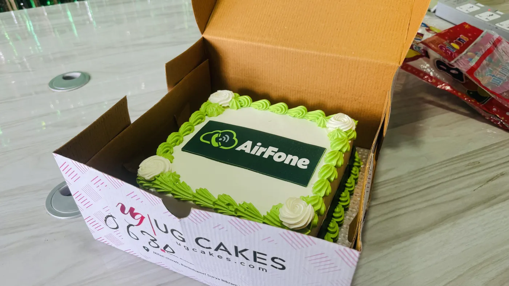
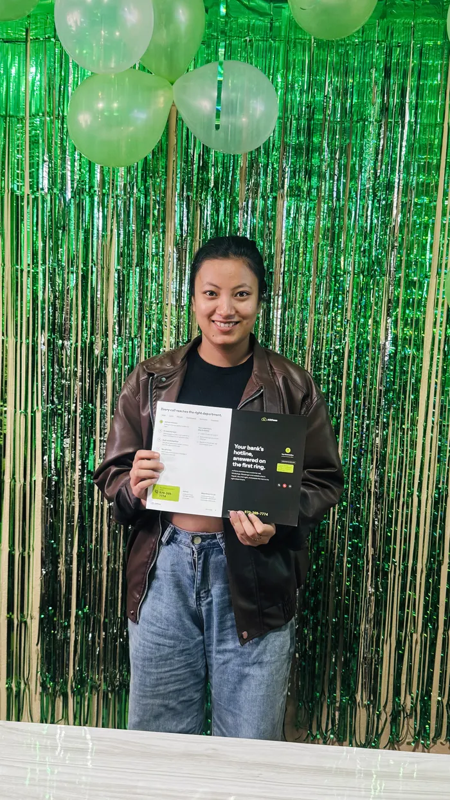

On 9 October 2026, Ninja Infosys pre-launched [AirFone](https://airfone.app), its business phone platform and AI call agent for Nepal. The launch was a private event for the people who built it. It marked the day AirFone moved from development to taking real calls for real businesses.

## What AirFone is

Most businesses in Nepal still run on a phone number and whoever is free to pick it up. When the desk is busy or closed, calls go unanswered and customers try somewhere else. AirFone is built to fix that.

At launch, AirFone gives a business:

- **An AI call agent** that answers calls in Nepali and English, handles common questions and bookings, and passes the call to staff with a summary when a person is needed.
- **A SIP line**, so the business keeps the number its customers already know and connects it to AirFone.
- **A chatbot and voice agent for websites**, so visitors can ask a question by typing or speaking without picking up the phone.
- **A merchant portal**, where a business sets up its agent, listens to calls and reads what was said.
- **A reseller portal**, for partners who set up and support AirFone for their own customers.
- **A developer portal**, for teams that want to build AirFone into their own products. Developers go live on credit, with no approval queue.

The AirFone blog covers the product in more detail, starting with the [AI call agent guide](https://airfone.app/blog/ai-call-agent-guide) and [whether an AI can really speak Nepali on the phone](https://airfone.app/blog/nepali-voice-ai).

## Why a pre-launch

We chose to start small. A pre-launch lets the first businesses use AirFone on their real calls while the team watches every one closely. Phone calls are unforgiving. A pause that is fine in a chat window sounds broken on a call, and Nepali speech varies a lot from one caller to the next. The first weeks are where we learn the most, so we wanted the whole team close to them.

It also gave the team a chance to mark the moment together before the work of the public rollout begins.

## The day

The event was held at Ninja Infosys, with the team that designed, built and tested AirFone. There was a stage, green and white to match the brand, the first printed AirFone brochures, and a cake with the AirFone logo on it.

Each member of the team had their photo taken in front of the launch backdrop. AirFone is the work of engineers, designers, testers and the people who talked to businesses about what they needed. Every one of them is part of this launch.

## Where AirFone fits in Ninja Infosys

AirFone joins the other Ninja Infosys products: [ePahichan](https://epahichan.com) for digital signatures and [LunaCam](https://lunacam.app) for camera monitoring. Each one serves different customers, but they share the same foundations, such as sign-in, billing, hosting and backups. That shared groundwork is part of why a small group can bring a product like AirFone to market. Our post on [what products in a group should share](/blog/what-products-should-share) explains how we decide what to share.

## What comes next

After the pre-launch, AirFone opens to more businesses in stages. The first users are clinics, hotels, banks and shops that take many calls and miss too many of them. We will keep listening to calls, fixing what callers stumble on and widening access as it holds up.

If your business misses calls, or you want to resell or build on AirFone, visit [airfone.app](https://airfone.app).

Thank you to everyone at Ninja Infosys who made AirFone real.
