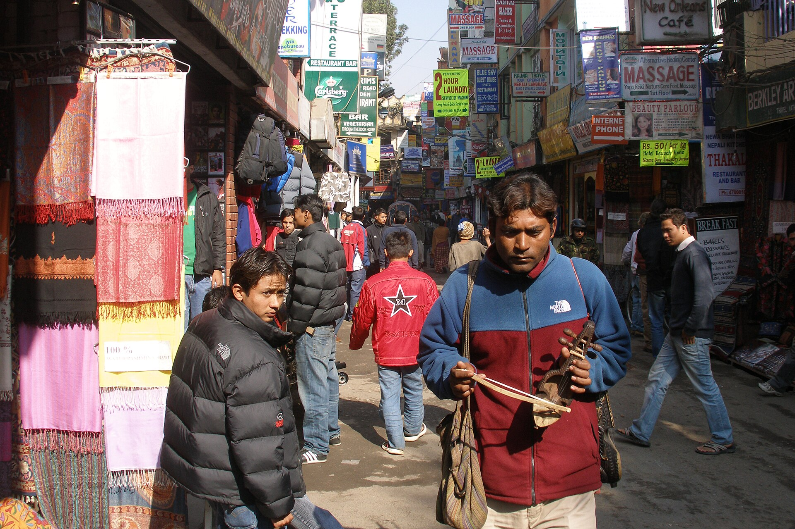

When a team is busy and results are slow, the cause is usually not effort. It is too many things started and not finished. Each open item holds attention, and attention does not come back when you switch.

## Put a number on it

Choose how many things each team may have in progress, and make it small: two or three for a team of a few people. When the limit is reached, finishing something is the only way to start the next.

## Finish before you review

A task that is "almost done" is still occupying a slot. Count it as open until it is released or handed over. This is uncomfortable at first because the board looks full. That is the information you wanted.

## Protect long blocks

Meetings spread across the day break work into pieces too small to use. Put them together on fixed days and leave the rest for the work itself.

## Write down decisions

A decision that lives in a conversation gets made again. A decision written in two lines can be found, questioned and left alone. Across several products, that saves more time than any tool.
