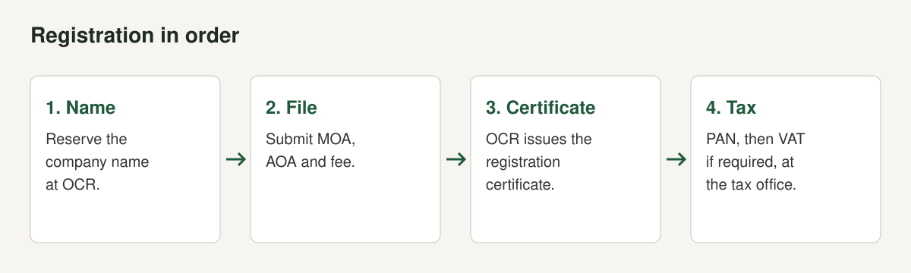
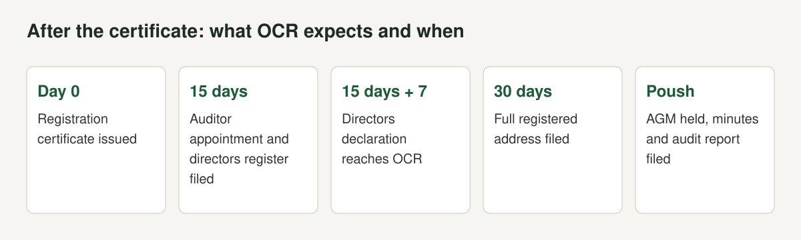

Registering a company is the least interesting part of building software and the part that blocks everything else. You cannot open a business account, sign a serious contract, bid for public work or issue a proper foreign invoice without it. This guide sets out the steps for a private limited company in Nepal, the fees and deadlines we could verify, and the points where we could not.

We opened these sources: a [Pioneer Law guide to company registration (2022)](https://pioneerlaw.com/wp-content/uploads/2022/06/company-jun29.pdf), [NepalLaws's CAMIS guide (October 2025)](https://nepallaws.com/company-registration-process-in-nepal-complete-step-by-step-guide-2082-camis-update/), the VAT Act text on nepallaws.com, Alpine Law Associates' VAT guides and Pioneer Law's outward investment handbook. We could not open the OCR's own fee page, so fees below are from the Pioneer Law guide and may have changed. We are a software group, not a law firm. This is not legal or tax advice. Check each fee and deadline with the OCR and the Inland Revenue Department (IRD) before you file.

## Which structure

Pioneer Law lists three vehicles for starting a business: sole proprietorship, partnership firm and company. For a software startup it says a private limited company is the commonly registered vehicle. A company has a distinct legal identity, can own property in its own name, and its members have limited liability, which a sole proprietorship or partnership lacks.

| Type | Shareholders | Capital rule | Source |
|---|---|---|---|
| Private company, single shareholder | One | No specific requirement | Pioneer Law |
| Private company, multiple shareholders | Up to 101 | No specific requirement | Pioneer Law |
| Public company | At least 7 | Minimum NPR 1 crore | Pioneer Law |

The guide says shares of a private company are restricted from public trading, that a single shareholder may register a start-up as a single-shareholding private company, and that it must convert to a multiple-shareholding company if more than one investor joins. Startups tend to register a private company because a public company carries more compliance.

## The process, step by step

The OCR runs registration through CAMIS, the Company and Management Information System. Pioneer Law's guide describes four steps for both private and public companies: name reservation request, document upload and submission of details, payment of fees, and receipt of the registration certificate. NepalLaws's CAMIS guide gives the longer working sequence:

1. **Create a CAMIS account.** Register as a new user, verify by email and OTP, complete your profile and upload a photo and ID.
2. **Reserve the name.** Search your proposed name in English and Nepali, prepare at least three alternatives, submit the reservation form with business activity details, upload documents and pay the reservation fee.
3. **Draft the memorandum of association (MOA) and articles of association (AOA).** Print them on the correct stamp paper and sign with each witness.
4. **Complete the CAMIS application.** Enter company information, share capital, promoters, directors and shareholders, upload scanned documents, photos and directors' consent letters.
5. **Pay fees.** CAMIS calculates fees automatically. Pay by bank, mobile app or digital wallet and save the receipt. The application is submitted automatically.
6. **Track the application** and answer any OCR query.
7. **Physical verification.** Bring original documents when OCR asks.
8. **Receive the certificate** and check its details.
9. **Obtain a PAN** from the IRD, uploading your certificate, MOA and AOA, directors' citizenship or national ID and proof of the registered office.
10. **Register for VAT** if required.
11. **Open a company bank account.**

We could not find an official source for the reservation fee amount, so we do not state one.

## Documents

Pioneer Law lists the core set for a private company:

| Document | Format | Copies |
|---|---|---|
| Application for company registration | OCR format, one for single and one for multiple shareholding | One set of originals |
| MOA | OCR format | Two sets of originals |
| AOA | OCR format | Two sets of originals |
| Citizenship of promoters | Notarised copy | One each |
| Citizenship of witnesses | Notarised copy, one witness per promoter | One each |
| Promoters or consensus agreement, if any | No OCR format. Register it at OCR for legality | One copy |
| Registration certificate, MOA and AOA of a corporate promoter | Copy of each | One |
| Corporate resolution of a corporate promoter | No OCR format | One |

Draft the MOA's objects with care. It states what the company may do. Clauses naming software development, data processing and related IT services also line up with the Industrial Enterprises Act categories used for IT industry status, which we cover below.

## OCR fees

The government fee depends on authorised capital. Pioneer Law's table for private companies, which we opened (checked October 2026):

| Authorised capital (NPR) | Fee (NPR) |
|---|---|
| Up to 1,00,000 | 1,000 |
| 1,00,001 to 5,00,000 | 4,500 |
| 5,00,001 to 25,00,000 | 9,500 |
| 25,00,001 to 1,00,00,000 | 16,000 |
| 1,00,00,001 to 2,00,00,000 | 19,000 |
| 2,00,00,001 to 3,00,00,000 | 22,000 |
| 3,00,00,001 to 4,00,00,000 | 25,000 |
| 4,00,00,001 to 5,00,00,000 | 28,000 |
| 5,00,00,001 to 6,00,00,000 | 31,000 |
| 6,00,00,001 to 7,00,00,000 | 34,000 |
| 7,00,00,001 to 8,00,00,000 | 37,000 |
| 8,00,00,001 to 9,00,00,000 | 40,000 |
| 9,00,00,001 to 10,00,00,000 | 43,000 |
| More than 10,00,00,000 | 30 for each 1,00,000 |

For a public company the same guide lists NPR 15,000 up to NPR 1 crore, NPR 40,000 up to NPR 10 crore and NPR 70,000 up to NPR 20 crore, rising to NPR 1,60,000 for NPR 40 to 50 crore. The schedule is set under company regulations and may be revised, so confirm on the OCR site. Notary charges, legal drafting and stamp paper are extra, and we found no published figure we could verify for them.

## Choosing authorised capital

The fee rises with authorised capital, so choose a figure that matches your plan. The guide says there is no specific minimum for a private company. A higher figure costs more now. A very low figure can mean amending it later as you grow. We did not find a rule that sets a floor for a private company, and we did not verify what any bank expects. Ask your bank before you decide.

## Timeline

Pioneer Law's guide reports that it takes around 15 days for OCR to approve the proposed company name, and then 7 to 10 working days for registration after approval and filing. Alpine Law's VAT guide says IRD processing for a clean VAT application is "typically a few working days", and it cross-checks at three to five working days, with the caveat that review and biometric requirements can change this. Treat all of these as guides.

## After registration: what you must file

Pioneer Law's guide lists the first compliance steps:

| Item | Deadline |
|---|---|
| Full details of the registered address | 30 days from registration |
| Appointment of auditor for the running fiscal year | 15 days from appointment |
| Directors' register | 15 days from appointment |
| Declaration of directors | Directors submit to the company within 15 days of appointment, and the company submits to OCR within 7 days of receiving it |
| Annual general meeting, AGM minutes and audit report to OCR | Within six months of fiscal year end, which is the month of Poush |

A company does not need to renew its registration. It exists until it is dissolved, though the guide notes a practice of obtaining a company update letter that shows compliance clearance. OCR may cancel registration if the company writes to ask, fails for three continuous years to submit annual statements or pay fines, or is found not operating.

Late filing costs money. NepalLaws reports that section 81(2) of the Companies Act sets fines by paid-up capital and delay:

| Delay | Capital up to NPR 25 lakh | Up to NPR 1 crore | Above NPR 1 crore |
|---|---|---|---|
| Up to 3 months | NPR 1,000 | NPR 2,000 | NPR 5,000 |
| 3 to 6 months | NPR 1,500 | NPR 3,000 | NPR 7,000 |
| 6 months to 1 year | NPR 2,500 | NPR 5,000 | NPR 10,000 |
| More than 1 year | NPR 5,000 | NPR 10,000 | NPR 20,000 |

The same article reports a 2081 ordinance that added clause (7) to section 81, giving a 90% discount on late-filing penalties for documents filed between Poush 2081 and Ashad 2082 (mid-January to mid-July 2025). That window has closed.

## PAN and VAT

PAN is the taxpayer number, and the CAMIS guide puts it right after incorporation, through the IRD portal.

VAT is separate. Section 10(2) of the Value Added Tax Act, 2052 says every person who intends to engage in a transaction shall apply to the tax officer for registration before commencing it. Section 10(3) exempts those whose transactions are only in goods or services listed in Schedule 1. Section 10(7) requires a registered person to inform the tax officer of changes within fifteen days.

The threshold is not in section 10. Alpine Law Associates reports that goods businesses cross it above NPR 50 lakh over a rolling 12 months and services or mixed businesses above NPR 30 lakh, that registration should follow within 30 days of crossing, and that some sectors may need to register regardless of turnover, listing software among them (checked October 2026). It notes older material used NPR 20 lakh for services. Confirm the current figure and sector list with IRD. A law firm's summary is not the rule.

Once registered, you must invoice. Section 14(1) requires every registered person to issue an invoice to the recipient on supplying goods and services, and section 18(1) requires a monthly return within twenty-five days of the month's end, even if no taxable transaction occurred. Alpine Law reports a penalty under section 29(1)(ka) of commonly NPR 10,000 per tax period for late registration.

For an exporter, voluntary registration can make sense. Alpine Law notes it can matter where an exporter considers input refunds on zero-rated sales, and that it brings monthly filing and record duties. Zero-rating of services to persons outside Nepal is in item 2 of Schedule 2. See [tax on software exports from Nepal](/blog/software-export-tax-nepal).

## IT industry registration

Registering the company is not the same as registering an industry. Pioneer Law's outward investment handbook says that before using the NRB outward investment route, an IT company must confirm its business falls within the definition of an IT industry under the Industrial Enterprises Act. The listed categories include technology park, IT park, biotech park, software development, data processing, cyber cafe, digital mapping, BPO or KPO, data centre, data mining and cloud computing, digital signature certifying agency, and web portal, web design, web hosting and online marketing and advertising service.

[Economic Khabar reported](https://economickhabar.com/detail/12067/) that the NRB facility for investing up to US$20,000 abroad targets companies registered as an "Information Technology Industry" at the Department of Industry or the Department of Cottage and Small Industries, and that a company registered only at OCR would need to complete industrial registration to be eligible. We could not open the NRB directive, so check the current text. The same IT industry classification is the hook for IT-specific tax provisions in section 11 of the Income Tax Act. See [tax on software exports from Nepal](/blog/software-export-tax-nepal).

## Foreign ownership

If a foreign investor holds shares, the route changes. Law Bhandari reports that a Nepal Gazette notice of 2 October 2023 removed the NPR 20 million minimum investment for IT companies, and that IT is on the positive list under the Industrial Enterprises Act and not on the negative list of the Foreign Investment and Technology Transfer Act ([source](https://lawbhandari.com/publication/registration-of-information-technology-(it)-business-in-nepal-through-the-route-of-foreign-direct-investment), checked October 2026). Foreign-invested companies cannot engage in trading activities, and the article warns that a branch office suits only companies that do not invoice Nepali clients. This post covers the all-Nepali path.

## What costs money

| Cost | Amount | Source | Checked |
|---|---|---|---|
| OCR registration fee, private company | NPR 1,000 to NPR 43,000 up to NPR 10 crore capital, by slab | Pioneer Law guide (2022) | October 2026 |
| Late annual filing fine | NPR 1,000 to NPR 20,000, by capital and delay | NepalLaws on section 81(2) | October 2026 |
| Late VAT registration penalty | Commonly NPR 10,000 per tax period | Alpine Law Associates on section 29(1)(ka) | October 2026 |
| Name reservation fee | Not found | CAMIS guide says a fee is payable | October 2026 |
| Notary, drafting, stamp paper | Not found | None | October 2026 |
| PAN fee | Not found | None | October 2026 |

Rows marked "not found" are things we could not confirm on a page we opened.

## Mistakes we see

- **Choosing a name last.** Name approval is the longest step. Prepare three alternatives before you submit.
- **Skipping the promoters' agreement.** Pioneer Law notes the agreement should be registered at OCR to ensure its legality. Agree who owns what before the MOA is signed.
- **Registering for VAT late.** The 30-day rule is a deadline, not a review date.
- **Missing the first filings.** Address in 30 days and auditor and directors' details in 15 days.
- **Letting the AGM slip past Poush.** The fines table above shows the cost.
- **Assuming company registration equals IT industry status.** They are separate registrations.

## A checklist

- [ ] Co-founders agree shares and roles in writing
- [ ] Three name options ready in English and Nepali
- [ ] MOA objects drafted to include software and IT services
- [ ] Authorised capital decided and OCR fee checked
- [ ] Citizenship copies notarised, witnesses arranged
- [ ] Application submitted on CAMIS and fee paid
- [ ] Certificate received, PAN and VAT decided with an accountant
- [ ] Registered address filed within 30 days, auditor within 15 days
- [ ] Bank account opened
- [ ] IT industry registration checked if you need IT-specific facilities
- [ ] AGM and audit calendar set before Poush

The next steps for a product company are the payment route, tax and hosting. The overview of the whole chain is in [building SaaS in Nepal](/blog/building-saas-in-nepal), the payment options are in [how to accept international payments as a Nepali software company](/blog/international-payments-nepal-software-company), and the wider export picture is in [Nepal's IT export boom](/blog/nepal-it-export-products).

## The short version

- Register a private limited company at OCR through CAMIS. Pioneer Law reports about 15 days for the name and 7 to 10 working days for registration.
- The fee follows authorised capital, from NPR 1,000 to NPR 16,000 up to NPR 1 crore. There is no stated minimum capital for a private company.
- File the address in 30 days, auditor and directors in 15 days and hold the AGM within Poush.
- Register for PAN, then for VAT before taxable transactions begin. Check the NPR 50 lakh and NPR 30 lakh thresholds with IRD.
- IT industry registration is separate and unlocks IT-specific facilities.

*This post is not legal or tax advice. Confirm current fees, thresholds and procedures with the OCR and the IRD.*
