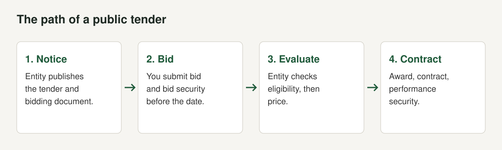

A government contract is attractive to a Nepali software company for obvious reasons. The buyer is large, the work can run for years, and a reference from a ministry or municipality helps every later sale. It is also a different way of selling. Nobody picks you because they liked the demo. The rules decide how you are chosen, and the rules are written down.

This post reads the written rules. We opened the Public Procurement Act, 2063 and the Public Procurement Rules, 2064 from the Law Commission copies, and we read the reporting on the 2083 amendment. We cite sections and rules so you can check each point. We are a software group, not a law firm, and the Act has been amended since the copies we opened, so this is not legal advice. Confirm every figure against the bidding document in front of you, which is the document that governs your bid. For hosting rules on government data, see [Nepal's data centre and cloud directive](/blog/nepal-data-center-cloud-directive-2081).

## The law, and what has changed

Public bodies buy goods, services and works under the Public Procurement Act, 2063 (2007) and the Public Procurement Rules, 2064. The Act is [published as Act No. 36](https://rdi.ku.edu.np/wp-content/uploads/2015/06/the-public-procurement-act.pdf) and the Rules, in the [Law Commission copy](https://www.fsmtoolbox.com/assets/pdf/32._Public-procurement-rule-2064.pdf), were framed under section 74 of the Act (both checked October 2026). The Public Procurement Monitoring Office (PPMO) oversees the system. Section 70 of the Act says the Act, Regulations and Procurement Manuals are to be kept on the PPMO website.

The text we opened predates a later change. In July 2026 the Act was amended. The [Kathmandu Post reported on 16 July 2026](https://kathmandupost.com/national/2026/07/16/government-tightens-procurement-law-with-criminal-penalties-faster-bidding-and-pricing-reforms) that Nepal had amended the Public Procurement Act to introduce criminal liability for contractors who misuse advance payments, shorten bidding timelines and change how contracts are awarded. [Ratopati](https://english.ratopati.com/story/71013/from-banning-unprepared-contracts-to-providing-social-security-to-workers-how-feasible-is-implementation) names it the Public Procurement (Second Amendment) Act, 2083. The PPMO spokesperson told the Post: "We will now prepare the required regulations, procedures and standards based on the amended law." Ratopati reports the PPMO is revising the Regulations, procedures and standard bidding documents.

That means three layers apply to a bid today: the Act, the Rules as amended, and the standard bidding document. Where this post cites the Rules, it cites the copy we opened and flags that the current text may differ.

## Who can bid

Section 10 of the Act sets qualification. A bidder must meet the qualification criteria in the bidding documents, or in the prequalification documents if prequalification was run. The criteria may cover professional and technical qualification, equipment, past performance, after-sale service, legal capacity, financial resources and punishment for professional offences. Two limits protect bidders. Under section 10(3) the criteria cannot be framed to allow only one class of supplier to participate or to bar a class, and under section 10(4) bids are evaluated only against the criteria in the documents, applied equally to all bidders. Under section 10(6) an entity may disqualify a bidder at any time if its qualification statement was factually false or substantially incomplete.

Rule 19(1) adds a registration condition. A public entity shall procure only from a person, firm, organisation or company that holds a permanent account number and a VAT registration certificate from the Inland Revenue Office. Sub-rule (2) provides exceptions, so read the whole rule. In practice this means a company has to be registered, with PAN and VAT, before it can bid. See [how to register a software company in Nepal](/blog/register-software-company-nepal).

## How a tender runs, section by section

**Notice (section 14).** A notice inviting bids must be published in a daily newspaper of national circulation. Section 14(2) requires it to be placed on the entity's website, or on the PPMO website for a central level entity. The notice must state the entity, the nature of the work and its time limit, and the bidding document must set out the bid security amount and validity (section 13 requires the bidding documents to state this).

**Submission (sections 17 to 19).** A bid must be in the specified form, signed by the bidder or authorised agent, in a sealed envelope, delivered by the last date and time (section 18(1)). Section 18(2) says bids received after the deadline "shall not be processed" and are returned unopened. Before the deadline a bidder may submit a sealed application to modify or withdraw its bid (section 19(1)).

**Validity (section 20, Rule 54).** The bidding documents set the validity period, which starts from the deadline for submission. Rule 54 requires the entity to state 90 days where the cost estimate does not exceed NPR 100 million and 120 days where it exceeds that. Extension needs the bidder's consent (section 20(4)).

**Opening and examination (sections 22 to 24).** Bids are opened on the day the deadline expires. Section 24 lists bids that are not processed: unsealed bids, bids outside the time frame, withdrawn bids, bids that fail the section 23(2) requirements, bids submitted by collusion and cancelled bids.

**Evaluation (section 25).** Minor deviations from the technical specification are valued and added to the price. If minor deviations exceed 15% of the bid price, the bid is "substantially non-responsive" and excluded (section 25(3)). Bids are evaluated by the criteria in the documents. The bid with the lowest evaluated price has its qualification verified, and if it qualifies it becomes the "lowest evaluated substantially responsive bid" (section 25(5) to (7)). The 2083 amendment changes this for construction contracts by replacing the lowest price with an average bid method, according to the Kathmandu Post, so check whether a software or services tender is affected.

**Award (section 27).** The entity selects the lowest evaluated substantially responsive bid and, within seven days, serves notice of intent to accept it and tells the other bidders the winner's name and price (section 27(2)). If no bidder applies for review under section 47 within seven days, the bid is accepted and the winner is told to furnish performance security and sign the contract within fifteen days (section 27(3)). If the winner fails, its bid security is forfeited and the next lowest evaluated bidder is offered the contract (section 27(5)).

| Step | Period | Source |
|---|---|---|
| Notice of intent to accept the selected bid | Within 7 days of selection | PPA section 27(2) |
| Window to apply for review before acceptance | 7 days from the notice | PPA sections 27(3) and 47(3) |
| Furnish performance security and sign contract | 15 days from the acceptance notice | PPA section 27(3) and (4) |
| Return of tender security after contract signing | No later than 3 days | Rules, Rule 53(8) |
| Tender validity | 90 days up to NPR 100 million, 120 days above | Rules, Rule 54 |

Under the Second Amendment, the Post reports that national-level tender submission periods fell from 30 to 21 days, re-tendering from 15 to 7 days, and international tenders from 45 to 30 days, with re-tender periods from 21 to 15 days.

## Money you have to put up

Public tenders move money in three places: security with the bid, security with the contract, and advances paid to the supplier. The Rules fix the instruments.

| Instrument | Rule | Amount and conditions |
|---|---|---|
| Tender (bid) security | Rule 53 | Furnished with the tender, by reference to the tender price, in cash or as a guarantee from a commercial bank. Valid at least 30 days beyond tender validity. A foreign bank's guarantee must be counter-guaranteed by a Nepali commercial bank. |
| Performance guarantee | Rule 110(2) | 5% of the procurement contract price, from a commercial bank, valid at least one month beyond delivery or the end of the warranty or defects liability period. |
| Advance payment | Rule 113(2) | Not more than 20% of the contract price, against a commercial bank guarantee covering the advance. |
| Retention money | Rule 124(2) | Half returned with the performance guarantee after the defects liability period in construction. The other half is returned on proof from the Inland Revenue office that income returns were submitted. |

Notes on each, all from the text we opened:

- **Bid security** is the one most bidders get wrong. Rule 53 sets the sum by reference to the tender price, but the actual figure appears in your bidding document, so take it from there. Rule 53(3) says the entity must respond immediately if you ask whether a particular bank's guarantee is acceptable. Ask before you pay for one.
- **Forfeiture.** Section 21(2) lists six grounds for forfeiting bid security: modifying or withdrawing the bid during its validity after the deadline; refusing correction of arithmetical errors; a selected bidder failing to sign the contract; failing to furnish performance security within the signing period; changing the bid price or substantive matter while answering clarifications; and conduct banned under section 62. Section 21(3) requires return of the security to the bidder who signed and to bidders whose security is not liable to forfeiture after the contract is concluded.
- **Performance guarantee.** Rule 110(3) says that if a contract states no price, the guarantee specified in the tender documents applies. Rule 65(3) adds that for construction works an unusually low bid may be accepted only with an additional performance security of eight percent of the tender price. That applies to construction tenders, not software.
- **Advances.** Rule 113(3) requires a bank guarantee that covers the advance and promises payment on demand if the supplier fails to perform. The Post reports that the 2083 amendment makes deliberate misuse of advances a criminal matter under section 58A(3) of the amended Act. This is a point for software vendors paid in milestones: an advance is a loan against performance, and it carries consequences.

## The 2083 amendment, in the parts a software company will meet

We only report what the two articles say. We have not seen the enacted text.

- **Award method.** The Post says the lowest-price system is replaced by an average bid method for construction: the contract goes to the bidder closest to the average of all bids, provided the bid does not exceed the official estimate, and bidders quoting more than 30% below the estimate are removed. Ratopati quotes the minister saying the new rules aim to select "fair prices, not just the lowest" bid, using average bid evaluation, quality-cost-based selection and a re-evaluation of contractors' qualifications. It is not clear from either article how this applies to software or consultancy.
- **E-marketplace and reverse auction.** Ratopati reports that the amendment legally recognises both for the first time. The PPMO's acting secretary describes the e-marketplace as an online portal where government offices put the details and quality of goods they need and suppliers quote competitive prices, citing purchases such as laptops and printers. PPMO told Ratopati it is building the platforms and a separate procedure. For a software vendor, an e-marketplace listing may become a route to small purchases, but the rules were not final when we checked.
- **Domestic goods.** Ratopati reports a provision that only goods with at least 30% value addition are considered domestic. It speaks of goods, not software, so we do not draw a conclusion for software.
- **Variation orders.** The Post reports approval limits for variations, from 5% for third-class gazetted officers up to 15% for first-class, with changes beyond that going to department heads.
- **Cancellation.** If a contract is cancelled for contractor failure, authorities seize the performance security and recover the rest of the extra cost from the updated estimate, which is treated as a government due.
- **Consultants and joint ventures.** Ratopati says consultants bear responsibility for faulty designs and that all joint venture partners are made equally accountable.
- **Price adjustment.** In exceptional circumstances such as crises, wars or supply disruptions agencies may revise prices, under procedures the Cabinet approves.

Rule 64(4) is also relevant to local firms. If the tender documents provide for preference to domestic goods and local construction entrepreneurs, the evaluation committee adds a preference price to the tender price of a foreign bidder. Whether a document gives that preference is a matter for the document.

## Where e-GP fits

Section 69 of the Act lets the Government of Nepal, by gazette notice, set up a mechanism by which a public entity may invite prequalification, issue bid notices, transmit documents, receive bids, conclude contracts, make payments and give notices by electronic means. It requires that the communications be legally valid and preserved, that security be adequate and that bidders' access not be restricted improperly. e-GP is the name of the electronic procurement system. We could not open the portal's own guides, so we do not describe its screens or its registration steps. Read the instructions in the bidding document, and register early if a notice says registration is required before you can buy the document.

## What to prepare before a notice appears

These steps come from how the rules operate. Each is tied to a section or rule above.

1. **Registration papers.** Company registration, PAN and VAT certificates, and tax clearance as the document requires (Rule 19). A company that is not VAT registered cannot normally bid.
2. **A bank that issues guarantees.** Bid security and performance guarantee come from a commercial bank (Rules 53 and 110). Ask your bank how long a guarantee takes and what it charges, in writing, before a deadline forces the question.
3. **Evidence of experience.** Section 10 allows past performance to be a criterion. Collect completion letters as each project finishes.
4. **A read of the specification for brand lock-in.** Section 10(3) bars criteria that allow only a particular class of supplier. If a specification is written around one product, use the clarification process (section 16) in writing, within the deadline.
5. **A hosting plan.** Decide where the system will run and what it costs. See the [directive guide](/blog/nepal-data-center-cloud-directive-2081) for Tier 3 rules on government data.
6. **A privacy position.** If the system holds citizens' personal information, a public body must protect it under section 25 of the Privacy Act, so expect the entity to ask what you do. See [the Privacy Act and apps](/blog/individual-privacy-act-2075-apps).
7. **Cash for the gap.** Guarantees tie up credit lines, and payment can be slow. Plan the cash before you bid.

## Mistakes we see

- **Missing the deadline by minutes.** Section 18(2) is absolute. Late bids are returned unopened.
- **Forgetting the guarantee's validity.** Rule 53(2) requires bid security valid at least 30 days beyond the tender validity. A guarantee that expires early can sink a bid.
- **Changing the price in a clarification.** Section 21(2)(e) makes this a ground for forfeiture.
- **Not reading the review window.** Seven days is short. If you think an evaluation is wrong, apply under section 47 within the period, and before the contract takes effect.
- **Treating an advance as income.** Rule 113 requires a guarantee for it and the Post reports new criminal exposure for deliberate misuse.
- **Quoting a price that cannot be delivered.** The reporting on the 2083 amendment describes contractors who bid 40 to 50% below estimate, took advances and left projects unfinished. The new rules try to stop it, and entities will look harder at very low bids.

## Where this fits in a product strategy

Public contracts can fund a product, but they can swallow a small team. A fixed-price contract with slow payment and changing requirements is a heavy load. Decide in advance what share of capacity you will give it. We wrote about how a group makes that choice in [capital allocation for a small group](/blog/capital-allocation-for-a-small-group), and about the wider export picture in [Nepal's IT export boom](/blog/nepal-it-export-products). NAS-IT has asked that software contracts up to NPR 100 million go to local firms, according to Bangladesh Monitor, but that is a request, not law.

## A pre-bid checklist

- [ ] Company registered, PAN and VAT certificates current
- [ ] Bidding document read in full, including the evaluation method
- [ ] Questions sent in writing during the clarification period
- [ ] Bid security guarantee issued, with validity at least 30 days beyond the tender validity
- [ ] Bid signed, sealed and delivered before the deadline
- [ ] Performance guarantee arranged in advance (5% of contract price)
- [ ] Hosting facility named and rated, if government data is involved
- [ ] Cash plan for guarantees and delayed payment

## The short version

- The governing texts are the Public Procurement Act, 2063 and the Rules, 2064, amended by the Second Amendment Act, 2083.
- Bids need PAN and VAT registration (Rule 19), sealed submission before the deadline (section 18) and bid security as the document states.
- After selection: notice in 7 days, review window of 7 days, performance security and signing within 15 days (section 27).
- Performance guarantee is 5% of the contract price and advances are capped at 20% with a bank guarantee (Rules 110 and 113).
- The 2083 amendment changed award methods, bidding periods and added an e-marketplace and reverse auction, and the regulations were still being drafted.

*This post is not legal advice. Check the current Act, the Rules as amended and your bidding document before you bid.*
