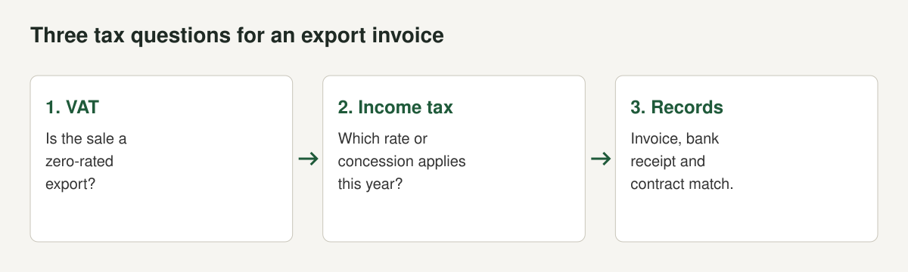
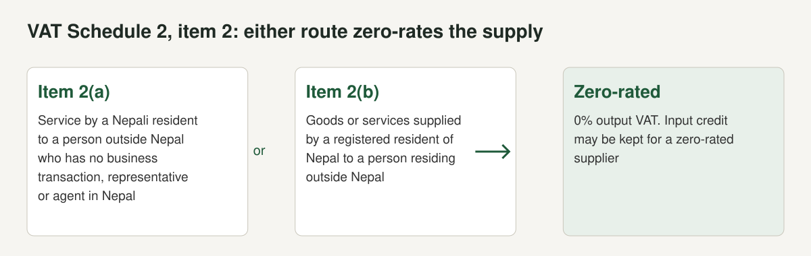

Tax is where software exporters most often lose money by assuming. A concession that applied last year may not apply this year, and a rule that suits a freelancer may not suit a company. NAS-IT's president put the sector's complaint plainly to the Kathmandu Post: "Tax rates change every year. We need stability for at least 10 to 15 years."

This guide sets out what we could verify about VAT and income tax on software exports from Nepal, with section numbers. We opened the [Income Tax Act, 2058 section 11](https://nepallaws.com/Laws/income-tax-act-2058-2002/chapter-4-exemptible-amounts-and-other-exemptions/section-11-professional-exemptions-and-facilities/), the VAT Act on nepallaws.com (sections 10, 14 and 18, and Schedule 2), and law-firm and press summaries of the 2082/83 and 2083/84 budgets. We could not open the Finance Acts themselves, so budget figures below are reported, not confirmed. We are a software group, not accountants, and nothing here is tax advice. Confirm the position with the Inland Revenue Department (IRD) or a chartered accountant before you file.

## VAT on software exports

### The rate and the zero-rate rule

Alpine Law Associates reports the standard VAT rate at 13%, unchanged in the 2082/83 and 2083/84 budgets. The Act separates three categories: standard-rated supplies at 13%, zero-rated supplies at 0% listed in Schedule 2, and exempt supplies listed in Schedule 1.

For exporters the key text is [Schedule 2, item 2](https://nepallaws.com/Laws/value-added-tax-act-2052/schedule-2-relating-to-sub-section-2-of-section-7/goods-and-services-subject-to-zero-rate/), headed "Services to be supplied to persons outside Nepal" (checked October 2026):

- (a) A supply of services by a person residing in Nepal to a person outside Nepal, who has no business transaction, business representative or legally recognised agent in Nepal.
- (b) A supply of goods or services by a person who is residing and is registered in Nepal to a person who is residing outside Nepal.

The two items are alternatives. Two conditions in that text matter. In (a) the foreign customer must have no business transaction, representative or agent in Nepal, so a foreign customer with a Nepali branch is a different case. In (b) the supplier must be registered. If you are not VAT registered, (b) does not describe you.

### Why zero-rated is better than exempt

Alpine Law explains the difference. A zero-rated supply carries 0% output VAT, but the supplier can keep input tax credit on eligible purchases and, according to the guide, may be eligible for a refund within the statutory window. An exempt supply carries no VAT, but input tax on related purchases is generally unavailable, so the VAT becomes a business cost. For a software company that pays VAT on laptops, internet, cloud services and office rent, that difference is real money.

### Registration

Section 10(2) of the VAT Act: "Every person, who intends to engage into a transaction after the commencement of this Act, shall apply to the Tax Officer in the prescribed format for registration, before the commencement of such transactions." Section 10(3) exempts people who deal only in the goods or services in Schedule 1. Section 10(7) requires a registered person to tell the tax officer of any change in registration details within fifteen days.

The turnover threshold is not in section 10. Alpine Law reports that goods businesses cross it above NPR 50 lakh over a rolling 12 months and services or mixed businesses above NPR 30 lakh, with registration within 30 days of crossing, and that some sectors, with software listed among them, may need to register regardless of turnover. It also says voluntary registration can matter for an exporter considering input refunds on zero-rated sales, at the cost of monthly filing and records. It notes that older articles used NPR 20 lakh for services. We could not open the IRD text for the threshold, so confirm it. Registration steps are in [how to register a software company in Nepal](/blog/register-software-company-nepal).

### Invoices and returns

Section 14(1): every registered person must issue an invoice to the recipient on supplying any goods and services, save the circumstances prescribed. Section 18(1): every taxpayer must submit the tax return within twenty-five days of the end of each month, "whether or not a taxable transaction was carried out in that month". Alpine Law adds that VAT invoices should show supplier, customer and VAT amount details, and that purchase invoices support input credit.

### VAT penalties

Alpine Law reports these amounts. They have different triggers and are not added together automatically.

| Trigger | Amount reported | Source | Checked |
|---|---|---|---|
| Non-registration | NPR 10,000 to NPR 20,000 per tax period | Alpine Law, VAT guide | October 2026 |
| Operating without required registration | Additional 50% of payable tax | Alpine Law, VAT guide | October 2026 |
| Late payment | 15% annual interest and a 10% penalty | Alpine Law, VAT guide | October 2026 |
| Late return | NPR 1,000 minimum plus 0.05% per day | Alpine Law, VAT guide | October 2026 |
| Late registration | Commonly NPR 10,000 per tax period under section 29(1)(ka) | Alpine Law, VAT registration guide | October 2026 |

### When you are the buyer

If you buy software or cloud services from a foreign vendor, Alpine Law says VAT on imported services is collected by the resident recipient through reverse charge at the time of payment to the non-resident. It also reports a 2% digital service tax on foreign B2C digital providers selling to Nepal-resident customers above NPR 3 million annual Nepal turnover, with B2B exempt and non-resident providers required to register and issue VAT invoices. These matter if you pay for tools from abroad, and for the dollar card limits we cover in the [payments guide](/blog/international-payments-nepal-software-company).

## Income tax on export income

### What the Act says

Section 11 of the Income Tax Act, 2058 lists professional exemptions and facilities. The sub-sections we opened that matter to software companies:

| Provision | What it says | Source |
|---|---|---|
| 11(3E)(c) | A person who earns foreign currency by exporting IT-based services such as business process outsourcing, software programming and cloud computing "will be taxed up to fifty percent of the income earned in foreign currency up to the year 2084/85". | nepallaws.com, section 11 |
| 11(3E)(a) | Export income of a resident natural person taxed at 20% gets a 25% exemption of the tax, and at 30% a 50% exemption. | nepallaws.com, section 11 |
| 11(3E)(b) | Twenty percent of tax leviable on an entity's export income is exempt. | nepallaws.com, section 11 |
| 11(3)(a) | A special industry or information technology industry giving direct employment to 100 or more Nepali citizens pays 90% of the normal rate, 300 or more pays 80%, 500 or more pays 75% and 1,000 or more pays 70%. An extra 10% applies if one third of 100 or more employees are women, Dalits or persons with disabilities. | nepallaws.com, section 11 |
| 11(3C) | Software development, data processing, cyber cafes and digital mapping in a designated technology or IT park get a fifty percent exemption. | nepallaws.com, section 11 |
| 11(3I) | Royalty from exporting intellectual property gets a 25% exemption of the tax. | nepallaws.com, section 11 |
| 11(3J) | Income from selling intellectual property through transfer gets a 50% exemption of the tax. | nepallaws.com, section 11 |

The English translation of 11(3E)(c) is ambiguous. "Taxed up to fifty percent of the income" could mean a 50% exemption, which is how the reporting on later budgets describes it. We do not know the date of the consolidated text on nepallaws.com, so treat it as the statute's baseline and read the current Finance Act for the percentage in force. For a product company, the clauses on intellectual property are worth a conversation with your accountant: a software licence to a foreign customer can be a royalty or a service, and the label changes the concession.

### What the budgets announced

Budgets layered new percentages on that baseline.

| Year | Announcement reported | Source | Status |
|---|---|---|---|
| 2082/83 | 75% exemption on IT export earnings, described as an effective rate of around 5%. Standard corporate rate 25%. | [Alpine Law, Budget 2082/83](https://lawalpine.com/blog/budget-2082-83-tax-changes-in-nepal) | Reported. Alpine tells readers to verify the gazetted wording. |
| 2083/84 | Exemption reset to 50% from 75%. 100% exemption for IT sweat equity. Standard corporate rate 25%. | [Alpine Law, Budget 2083/84](https://lawalpine.com/blog/budget-2083-84-tax-changes-in-nepal) | Reported. Applies from 1 Shrawan 2083. |
| 2083/84 | 50% income tax exemption for IT service exports. | [Business 360](https://www.b360nepal.com/detail/29119/nepals-it-budget-208384) | Reported |

Alpine's 2083/84 summary advises companies that built 2082/83 cash-flow models on the 75% figure to re-forecast their effective tax rate before 1 Shrawan 2083. The point for a planner is that the percentage moved between two budgets in a row.

A consultancy summary, [Niti Partners](https://nitipartners.com/nepal-it-business-incentives-2026/), says companies exporting software, data processing and digital services can claim tax rebates if payments are received in convertible foreign currency through banking channels, that contracts, invoices and bank statements are required, that startups under NPR 10 crore turnover can get a full exemption for five years, and that individual freelancers pay a final 5% withholding tax on export income received through formal channels. It cites no statute section, so we treat it as a lead to check with IRD, not a rule.

### Other concessions reported for software companies

Alpine Law's summaries and a consultancy list several other measures. We include them as leads to check, not as confirmed rules.

| Measure | What is reported | Source |
|---|---|---|
| IT services effective rate, 2082/83 | A 20% rebate on the standard rate, giving a 20% effective rate | [Alpine Law, Budget 2082/83](https://lawalpine.com/blog/budget-2082-83-tax-changes-in-nepal) |
| Startups, 2082/83 | 100% income tax exemption for 5 years for startups with turnover under NPR 10 crore, described as extended or clarified. The operational definition of startup still decides eligibility | Alpine Law, Budget 2082/83 |
| IT parks, bio-tech and zoological parks, 2082/83 | Exemption raised from 50% to 75% | Alpine Law, Budget 2082/83 |
| IT sweat equity, 2083/84 | 100% income tax exemption for stock or stock-equivalent compensation issued to IT employees in lieu of cash salary | [Alpine Law, Budget 2083/84](https://lawalpine.com/blog/budget-2083-84-tax-changes-in-nepal) |
| Enterprise financing, 2083/84 | NPR 500 million for the Nepal Enterprise Facility and NPR 4 billion for science, technology and innovation | Alpine Law, Budget 2083/84 |
| Digital payment incentive | Section 25(1b) of the VAT Act: ten percent of a consumer's electronic payment is refunded to their bank account as a cash incentive, under the Department's procedure | [VAT Act section 25](https://nepallaws.com/Laws/value-added-tax-act-2052/section-25-tax-may-be-refunded/) |

The two IT-park rows disagree with the statute text we opened, which gives 50% in section 11(3C). Alpine says the budget raised it, and we found no enacted wording. Alpine also says that the operational definitions of "startup" and "innovation" published by the relevant ministries will determine eligibility for the startup package.

### What this means in practice

- **Which year's rate?** Ask your accountant which fiscal year's rule applies to each receipt. Alpine Law says the 2083/84 changes take effect from 1 Shrawan 2083, which is mid-July 2026.
- **Which entity?** The reporting covers companies and individuals differently. Check which applies.
- **Which income?** A product company may have export services, export licences, local sales and platform income. Each may need separate accounting.
- **What proof?** Keep the contract, the invoice and the bank record for each export so they agree on customer, service and amount. That is common sense and the consultancy summary above says the same. We did not find a statutory proof list.

## Why records matter

NAS-IT's president told the Kathmandu Post that payments often come in labelled as remittance, which makes it hard to tell payment for IT services from personal remittance. Income that arrives as remittance cannot easily be shown as export revenue. For a company that wants zero-rating, a concession and a loan or investor, the cleaner the bank trail, the better. See [Nepal's IT export boom](/blog/nepal-it-export-products) for the statistical picture and the [payments guide](/blog/international-payments-nepal-software-company) for routes.

## What the sector is asking for

[Bangladesh Monitor](https://www.bangladeshmonitor.com.bd/en/nepals-it-service-exports-reach-estimated-usd-1-billion-annually-industry-s) reports that NAS-IT's treasurer asked for a stable 10-year policy framework, a corporate tax rate below 1% for at least a decade and a simpler VAT refund process. He said unclear tax provisions for foreign investors and the absence of double taxation avoidance agreements with the United States, the United Kingdom and Australia remain major obstacles. These are requests, not law.

## A tax calendar for an exporting software company

| When | What | Source |
|---|---|---|
| Before the first taxable transaction | Apply for VAT registration if required | VAT Act s.10(2) |
| Within 15 days of a change | Tell the tax officer of changes in registration details | VAT Act s.10(7) |
| Each transaction | Issue an invoice | VAT Act s.14(1) |
| Within 25 days after each month | File the VAT return, even if nil | VAT Act s.18(1) |
| Each budget (Jestha) | Read the announcements, then the Finance Act | Practice |
| Before the first filing of each year | Confirm the export concession rate in force | Practice |

## Mistakes we see

- **Treating a budget speech as law.** Alpine Law itself says to verify the final gazetted wording.
- **Building a business plan on an effective 5%.** The 2083/84 summaries report a different figure.
- **Skipping VAT registration** because turnover looks low. Zero-rating under item 2(b) of Schedule 2 refers to a registered supplier.
- **Missing nil returns.** Section 18(1) requires a return every month.
- **Forgetting reverse charge** on foreign tools.
- **Receiving export income informally** and then being unable to show it.

## A checklist

- [ ] Company registered, PAN issued
- [ ] VAT position decided with an accountant, registration filed before first taxable transaction if required
- [ ] Invoices issued with the correct VAT treatment
- [ ] Monthly VAT returns filed within 25 days
- [ ] Contract, invoice and bank record matched for every export
- [ ] Export concession rate for the year confirmed with IRD
- [ ] Reverse-charge treatment of foreign software agreed with the accountant

The overview of what a Nepali SaaS company must settle is in [building SaaS in Nepal](/blog/building-saas-in-nepal), and the registration steps are in [how to register a software company in Nepal](/blog/register-software-company-nepal).

## The short version

- Services supplied to persons outside Nepal are zero-rated in Schedule 2, item 2 of the VAT Act, for a registered supplier with a foreign customer who has no Nepali presence.
- Income Tax Act section 11(3E)(c) gives an IT service export concession stated as up to fifty percent, to the year 2084/85. Budgets reported 75% for 2082/83 and 50% for 2083/84, and we found no enacted text.
- Register for VAT before taxable transactions begin, issue invoices and file monthly returns within 25 days.
- Keep contract, invoice and bank record together for each export.

*This post is not tax advice. Rules change with each budget. Confirm with the Inland Revenue Department or a chartered accountant.*
